# ACS OS — Engineering v2.1 (พรพระนคร)

| รายการ | ค่า |
|---|---|
| เอกสาร | ACS OS Engineering v2.1 ฉบับรวม (standalone) |
| โครงการ | พรพระนคร — ACS OS (Linear `P-LIL-4`) |
| วันที่ | 2026-10-10 |
| ผู้จัดทำ | Claude (Solution Architect / Strategic Reviewer) |
| สถานะ | `DESIGN_DRAFT` · `IMPLEMENTATION_BLOCKED` · `NOT_DEPLOYED` · `REVIEWER_APPROVAL_NONE` |
| ฐานเดิม | ACS OS Engineering v2 (snapshot ในหน้า Notion "ACS OS — สกิลออกแบบวิศวกรรมฯ" แก้ไขล่าสุด 2026-10-09T03:31Z) |
| Verdict ของเอกสารนี้ | **REVISE** — ดู §11 |

> เอกสารนี้เป็น **แบบเสนอ** ไม่ใช่หลักฐานว่ามีระบบ ตาราง หรือ deployment แล้ว
> ไม่มีคำใดในเอกสารนี้ที่หมายถึง implementation, test success ของระบบจริง, reviewer approval หรือ deployment
> สิ่งเดียวที่ "รันจริง" คือ smoke test ของ DDL ที่เสนอบน PostgreSQL 16 ชั่วคราว (§3.8) ซึ่งพิสูจน์เฉพาะพฤติกรรมของ constraint/trigger ไม่ใช่ acceptance ของแอป

---

## สารบัญ

0. [แหล่งอ้างอิง ข้อจำกัด และวิธีอ่าน](#0-แหล่งอ้างอิง-ข้อจำกัด-และวิธีอ่าน)
1. [Engineering v2.1: ขอบเขต, changelog, discrepancy register, ข้อค้าง](#1-engineering-v21-ขอบเขต-changelog-discrepancy-register-ข้อค้าง)
2. [Architecture](#2-architecture)
3. [Data design](#3-data-design)
4. [Transactions และ concurrency](#4-transactions-และ-concurrency)
5. [Outbox](#5-outbox)
6. [Authorization และ security](#6-authorization-และ-security)
7. [Privacy lifecycle](#7-privacy-lifecycle)
8. [Prototype contract](#8-prototype-contract)
9. [ADR](#9-adr)
10. [Delivery และ acceptance](#10-delivery-และ-acceptance)
11. [ปิดท้าย: verdict, ข้อบกพร่อง, owner decisions, งานถัดไป, สิ่งที่ยังไม่ได้ตรวจ](#11-ปิดท้าย)

---

## 0. แหล่งอ้างอิง ข้อจำกัด และวิธีอ่าน

### 0.1 ทะเบียนแหล่งอ้างอิงที่เข้าถึงได้จริง

ตรวจเมื่อ 2026-10-10 ผ่าน Linear MCP, Notion MCP และ Google Drive MCP ของ session นี้

| ID | เอกสาร | เวอร์ชัน / เวลา | ที่อยู่ | สถานะการอ่าน |
|---|---|---|---|---|
| SRC-01 | TOR v0.1 ลงวันที่ 9 ต.ค. 2569 | — | — | **ไม่พบ** (ดู 0.2) |
| SRC-02 | ACS OS Engineering v2 (`ACS_OS_Engineering_v2.md`) | snapshot ในหน้า Notion แก้ไขล่าสุด 2026-10-09T03:31Z | Notion "ACS OS — สกิลออกแบบวิศวกรรมและส่งต่อ Claude → GitHub Copilot" `3f40b9cc…bbd76c` | อ่านครบ รวม prompt Claude/Copilot v2 |
| SRC-03 | ACS OS — Architecture Handoff และผลตรวจก่อนออกแบบ | แก้ไขล่าสุด 2026-10-09T03:35Z | Notion `3f40b9cc…177748` | อ่านครบ รวม Recheck 5 ข้อ |
| SRC-04 | เปิดโครงการ พรพระนคร — ACS OS | 2026-10-09T04:58Z | Notion `3f40b9cc…aff04f` | อ่านครบ |
| SRC-05 | Linear project P-LIL-4 "พรพระนคร — ACS OS" | สร้าง 2026-10-09T04:58Z, สถานะ Planned | Linear | อ่านครบ (resources 2 ลิงก์, ไม่มี milestone, ไม่มี Linear document) |
| SRC-06 | Linear LIL-34 "owner decisions ที่บล็อก discovery" | Backlog, priority High | Linear | อ่านครบ checklist 5 ข้อ ยังไม่มีข้อใดติ๊ก |
| SRC-07 | ACS OS — ลำดับงานตาม Final Review | 2026-10-09T02:54Z | Notion `3f40b9cc…e963ae` | อ่านครบ |
| SRC-08 | verybegin (spec-handoff-review skill) v1.2 | 2026-10-09T03:43Z | Notion `3f40b9cc…68` | อ่านครบ ใช้เป็น checklist ตรวจ |

ไม่ได้อ่าน: THE MIDDLE 100-Agent Blueprint (`dff8159c…`) และหน้า `22d3f2b7…` ที่ Handoff อ้าง — อ่านเฉพาะส่วนที่ SRC-02 สรุปไว้ จึงไม่อ้างเนื้อหา Blueprint โดยตรง

### 0.2 ข้อจำกัด (ต้องอ่านก่อนใช้เอกสาร)

1. **TOR v0.1 ไม่พบ** — ค้น Notion ("TOR พรพระนคร v0.1", "Terms of Reference ACS OS ข้อกำหนด FR NFR PDPA"), Google Drive (`fullText contains 'พรพระนคร' or title contains 'TOR' or fullText contains 'ACS OS'` ได้ไฟล์ที่ไม่เกี่ยวข้อง 1 ไฟล์), Linear documents ของ P-LIL-4 (ว่าง) ผลค้นเหล่านี้ไม่ได้พิสูจน์ว่า TOR ไม่มีอยู่ เพียงแต่ session นี้เข้าไม่ถึง **จึงไม่อ้างว่าอ่าน TOR และไม่สร้างรหัส FR/NFR/SEC/PDPA ของ TOR ขึ้นเอง** traceability ใน §10 ใช้รหัสข้อกำหนดชั่วคราว `REQ-*` ที่ดึงจาก SRC-02/03/06/07/08 และเว้นคอลัมน์ TOR ID ไว้ให้เติม
2. **ไม่มี repository เป้าหมาย** — repository ของ session นี้คือ `creativex2026-chula-cea-arithach` ซึ่งเป็นโครงการอื่น (เว็บไซต์ CreativeX/Kamakaben/The Middle) **ไม่ได้ใช้เป็นหลักฐาน existing stack** ใช้เป็นที่เก็บเอกสารออกแบบนี้เท่านั้น ดังนั้น "รักษา existing stack" ยังประเมินไม่ได้ และแผน PR ใช้ module references ไม่ใช่ file paths
3. **Owner decisions ใน LIL-34 ยังไม่มีคำตอบ** — ส่วนที่ขึ้นกับคำตอบติดป้าย `OWNER_BLOCKED`
4. **ไม่มีราคา provider, load, budget หรือ RPO/RTO** — ต้นทุนรายงานเป็น `COST_NOT_ESTIMABLE` (ตามกฎ SRC-08)

### 0.3 ป้ายกำกับ

| ป้าย | ความหมาย |
|---|---|
| **[E]** Evidence | มาจากแหล่งในตาราง 0.1 หรือผลรันจริงใน §3.8 พร้อมอ้าง ID |
| **[A]** Assumption | สมมติฐานเพื่อให้ออกแบบต่อได้ ต้องยืนยัน |
| **[P]** Proposal | ข้อเสนอทางวิศวกรรมของเอกสารนี้ ทีมพัฒนาเปลี่ยนได้เมื่อมีเหตุผล |
| **[OD-nn]** Owner decision | ต้องให้เจ้าของ/DPO/ที่ปรึกษากฎหมายตัดสิน ห้ามเดา (ทะเบียนใน §11.3) |

---

## 1. Engineering v2.1: ขอบเขต, changelog, discrepancy register, ข้อค้าง

### 1.1 เป้าหมายและขอบเขต

ระบบรับ Lead ติดตาม Deal และบันทึกข้อตกลงแบบมีเวอร์ชัน พร้อม private hub, หน้า public และ integration ที่ทนต่อความล้มเหลว เน้นความถูกต้อง ต้นทุนรวมต่ำ และดูแลได้ด้วยทีมเล็ก [E: SRC-03, SRC-04]

อยู่ในขอบเขต v2.1
- รับ Lead จากหน้า public (ไม่ต้อง login) พร้อม acquisition และ consent
- Private hub: รายการ/รายละเอียด Lead, Deal, terms versions, binding (และ approval หากเจ้าของยืนยัน)
- Audit, outbox, CRM handoff, privacy requests
- Public pages ตาม allowlist ที่เจ้าของอนุมัติ **[OD-03]**

นอกขอบเขต [E: SRC-07] — private supply/matching เต็มรูปแบบ, ภาษาเพิ่มเติมนอก TH/EN, newsletter, บทวิเคราะห์ตลาด, PMS, payroll/WorkPay, การ deploy

หลักการบังคับที่คงจาก v2 [E: SRC-02]
- modular monolith + PostgreSQL หนึ่งฐาน; ไม่เพิ่ม Redis/microservices/Kubernetes/AI ทุก lead โดยไม่มีข้อกำหนด โหลด หรือต้นทุนรองรับ
- outbox ใน Postgres เป็น **เจ้าของสถานะงานภายนอกแห่งเดียว**; ไม่ใช้ fire-and-forget ภายใน web request
- external effects เป็น at-least-once; ไม่อ้าง exactly-once
- เงินใช้ `numeric`/decimal; ห้าม float

### 1.2 Changelog เทียบ v2

| # | หัวข้อ | v2 | v2.1 | เหตุผล / แหล่ง |
|---|---|---|---|---|
| C-01 | Outbox fencing | มี lease expiry แต่ไม่มี token | เพิ่ม `lease_token` หมุนทุก claim/reclaim; heartbeat/ack/fail ต้องตรง id+token+`processing`+lease ยังไม่หมด (เวลาฐานข้อมูล) | REVISE item 1 ใน SRC-04; SRC-08 checklist |
| C-02 | Fencing vs external effect | ไม่ระบุ | ระบุชัดว่า fencing กันเฉพาะการเขียนสถานะของ worker เก่า ไม่กันผลภายนอกซ้ำ; provider ไม่มี idempotency + ผลไม่แน่นอน → `uncertain` → reconcile ก่อนส่งซ้ำ | SRC-08 v1.2 scenario |
| C-03 | Consent | ไม่มี | `consent_event` append-only + privacy notice version บันทึกใน transaction เดียวกับ lead | REVISE item 2 ใน SRC-04 |
| C-04 | Consent withdrawal | ไม่มี | ยกเลิก queued outbox events ของ purpose นั้นใน transaction เดียว + ตรวจ consent ซ้ำก่อน dispatch + suppression event ปลายทาง | คำสั่งงานนี้ ข้อ 7 |
| C-05 | Erasure | ไม่มี | PII อยู่ในตาราง mutable `lead` เท่านั้น; ตาราง immutable อ้างด้วย id; `erasure_ledger` สำหรับ re-apply หลัง restore; แยก anonymisation/pseudonymisation | REVISE item 2; คำสั่งข้อ 7 |
| C-06 | Outbox scheduler | "หากมี scheduler ที่เชื่อถือได้" | ADR-03: dispatcher module เดียว; runtime ขึ้นกับ hosting **[OD-05]**; ห้ามหลายระบบ retry อิสระ | REVISE item 3 |
| C-07 | Idempotency | key + hash | เพิ่ม scope (endpoint + scope_kind + scope_id), TTL ด้วย `expires_at`, พฤติกรรมหลังหมดอายุ, anonymous คืน acknowledgment เท่านั้น, replay ตรวจสิทธิ์ปัจจุบัน | REVISE item 4; SRC-08 |
| C-08 | Terms immutability vs approval | "approved terms version" | เปรียบเทียบ Option A/B/C (§3.4); baseline A ไม่มีตาราง approval; Option B เฉพาะเมื่อเจ้าของยืนยันขั้นอนุมัติ | คำสั่งงานนี้ ข้อ 3; SRC-03 Recheck 1 |
| C-09 | Immutability enforcement | ระบุแนวคิด | trigger ปฏิเสธ UPDATE/DELETE + ไม่มี `updated_at` บน terms/audit + REVOKE สิทธิ์ role แอป | คำสั่งงานนี้ ข้อ 3 |
| C-10 | Public scope | 6 หน้า 3 กลุ่มโดเมน (rental site) | เปลี่ยนเป็น "owner-approved allowlist"; 6 หน้าเดิมเป็น candidate จนกว่าเจ้าของยืนยันว่าใช้กับพรพระนคร | REVISE item 5; D-01 |
| C-11 | Event per destination | CRM แยกจาก LILITH/Slack | catalog event ต่อปลายทาง + `payload_version` + field whitelist (§5.6) | คำสั่งงานนี้ ข้อ 5 |
| C-12 | AI | optional, template default | เพิ่ม prompt-injection controls, output handling, budget hard stop, kill switch | คำสั่งงานนี้ ข้อ 9 |
| C-13 | Security | auth + CSRF + rate limit | เพิ่ม MFA สำหรับบทบาท staff, `Cache-Control: private, no-store`, threat model STRIDE | คำสั่งงานนี้ ข้อ 6 |
| C-14 | Prototype | ไม่มี | prototype contract แยกจากต้นแบบที่สร้างจริง (ยังไม่ได้สร้าง) | คำสั่งงานนี้ ข้อ 8 |
| C-15 | Acceptance | รายการ tests | แยก design / prototype / implementation acceptance + traceability | คำสั่งงานนี้ ข้อ 10 |
| C-16 | เวลา | 11–15 วันทำงาน | คง 11–15 เป็น reference; เพิ่ม scope delta ของ v2.1 และแยกต่อยอด vs สร้างใหม่ (§10.7) | SRC-08 estimation rules |

### 1.3 Discrepancy register

| ID | ความขัดแย้ง | แหล่ง | ผลกระทบ | ข้อยุติที่เสนอ | ผู้ตัดสิน |
|---|---|---|---|---|---|
| D-01 | ขอบเขต public 6 หน้า (.com/.asia/.online) เขียนไว้สำหรับ "เว็บไซต์เช่าทรัพย์" แต่โครงการนี้คือพรพระนคร | SRC-02, SRC-04 ("v2 เขียนไว้สำหรับเว็บไซต์เช่าทรัพย์"), SRC-06 | ถ้าใช้ผิดจะสร้างหน้าที่ไม่ใช่ของลูกค้า | ถือ 6 หน้าเป็น candidate allowlist; ไม่สร้างหน้าใดจนเจ้าของอนุมัติรายการ | เจ้าของ [OD-03] |
| D-02 | ประมาณเวลา 10–15 วัน vs 11–15 วัน | SRC-07 vs SRC-02/04/05 | ความคาดหวังกำหนดส่ง | ใช้ 11–15 (ผลรวม sequential ที่ตรวจแล้ว) เป็น reference; ทั้งสองไม่ใช่ commitment | Orchestrator |
| D-03 | ผู้ลงมือโค้ด: SRC-04 ให้ Codex เป็น Lead Engineer; SRC-07 ให้ Claude แก้โค้ดและ Codex ตรวจ; SRC-02 prompt ส่ง GitHub Copilot | SRC-02/04/07 | ความรับผิดชอบ PR และ reviewer ซ้ำซ้อน | ใช้ล่าสุด (SRC-04, 2026-10-09T04:58Z): Codex implement, Claude review; Copilot เป็นทางเลือก | เจ้าของ [OD-13] |
| D-04 | Binding: v2 บอก "ตรวจ approved terms version"; Handoff บอก "การอนุมัติ/เวอร์ชันเป็นข้อเสนอที่ต้องยืนยัน" | SRC-02 vs SRC-03 Recheck 1 | อาจสร้างตาราง approval ที่ไม่มีใครใช้ | baseline Option A (ไม่มี approval table); Option B เมื่อยืนยัน (§3.4) | เจ้าของ [OD-04] |
| D-05 | Routing threshold LILITH: Blueprint "volume > 50 หรือคำขยายกิจการ" vs workflow v1.1 "ต้องมีสัญญาณชัดและพื้นที่" | SRC-02 (ส่วนข้อขัดแย้ง) | ส่ง lead ข้ามองค์กรผิดเงื่อนไข | ไม่ออกแบบ routing ไป LILITH ใน v2.1; event `lilith.*` เป็น CONDITIONAL | เจ้าของ/ฝ่ายขาย [OD-10] |
| D-06 | ขอบเขต Handoff รวม "property search" และ LILITH แต่ LIL-34 ถามว่า v2 ใช้กับพรพระนครหรือไม่ | SRC-03 vs SRC-06 | scope creep | property search อยู่นอก v2.1 จนเจ้าของยืนยัน | เจ้าของ [OD-10] |
| D-07 | TOR v0.1 ถูกระบุเป็นแหล่งตั้งต้น แต่ไม่มีใน Linear/Notion/Drive ที่เข้าถึงได้ | คำสั่งงาน vs ผลค้น 0.2 | traceability ตรวจไม่ได้ | ใช้ `REQ-*` ชั่วคราว; map TOR ID เมื่อได้ไฟล์ | เจ้าของ [OD-01] |

### 1.4 รายการข้อค้าง (สรุป — รายละเอียดใน §11)

`OWNER_BLOCKED`: TOR, repo, public allowlist, binding/approval/currency/fees, hosting/region, budget/load/RPO/RTO, purpose/legal basis/retention, roles, CRM provider, ความสัมพันธ์ LILITH/The Middle, AI on/off
`ENGINEERING_OPEN`: ทดสอบ DDL กับ migration tool จริง, load test, restore drill

---

## 2. Architecture

### 2.1 Context diagram

ความสัมพันธ์ ACS/LILITH/The Middle อ้างเฉพาะหลักฐาน: SRC-03/04 วางเอกสาร ACS OS ไว้ใต้ "THE MIDDLE Blueprint" ใน Notion และ SRC-02 กำหนดว่า "แยกข้อมูล ACS/LILITH/The Middle ตามสิทธิ์ การเสนอขายร่วมใช้เฉพาะฟิลด์ที่ได้รับอนุญาต" **ไม่มีหลักฐานว่ามี integration ที่ทำงานอยู่** จึงแสดงเป็นเส้นประ CONDITIONAL

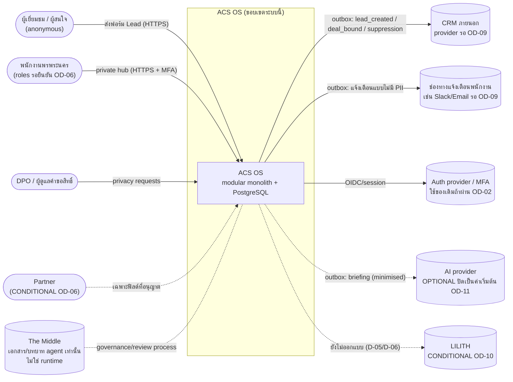

### 2.2 Container diagram

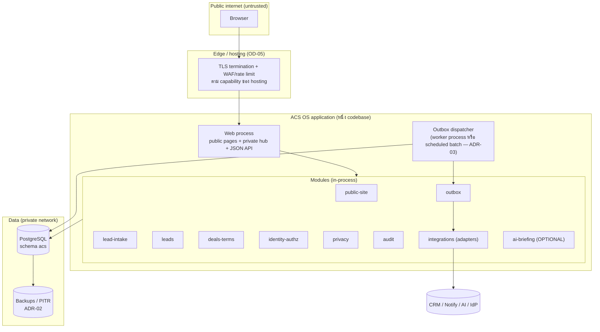

### 2.3 Trust boundaries

| ID | ขอบเขต | ฝั่ง untrusted → trusted | การควบคุม [P] |
|---|---|---|---|
| TB-1 | Public | browser anonymous → web | schema validation, payload limit, rate/abuse limit, signed form token, ไม่มีข้อมูลส่วนตัวในการตอบกลับ, CSP |
| TB-2 | Private | browser ที่ login → private hub/API | session + MFA (staff), server-side + record-level authz ทุก route, CSRF/origin, `Cache-Control: private, no-store`, `X-Robots-Tag: noindex` |
| TB-3 | Partner | partner → API ที่จำกัด | ปิดเป็นค่าเริ่มต้น; เปิดเมื่อ OD-06; field whitelist ต่อ record ที่แชร์ |
| TB-4 | External egress | app → CRM/notify/AI | ผ่าน outbox เท่านั้น, payload whitelist ต่อปลายทาง, secrets จาก runtime credentials, timeout ทุก call |
| TB-5 | External ingress | provider callback/webhook (ถ้ามี) → app | ตรวจลายเซ็น, replay window, treat เป็น data |
| TB-6 | Data plane | app → PostgreSQL | network private, role แอปไม่ใช่เจ้าของตาราง, least privilege, TLS ถ้า hosting รองรับ |
| TB-7 | AI content | ข้อความ lead/ผล AI → ระบบ | ข้อความทั้งหมดเป็น data, ไม่ให้ AI เรียกเครื่องมือ, output validate + escape (§9 ADR-04) |

### 2.4 Module responsibilities, interfaces และเจ้าของข้อมูล [P]

รายชื่อ module เป็น **ข้อเสนอ** ทีมพัฒนาปรับให้ตรงโครงสร้าง repo จริงได้หลัง discovery (PR-00) โดยรักษาหลัก "เจ้าของข้อมูลหนึ่งเดียวต่อตาราง"

| Module | รับผิดชอบ | Interface (เสนอ) | เจ้าของตาราง |
|---|---|---|---|
| public-site | render หน้า public จาก allowlist, sitemap/canonical/hreflang | HTTP GET; build-time หรือ request-time | — (เนื้อหาจาก CMS/ไฟล์ที่อนุมัติ) |
| lead-intake | รับฟอร์ม, validate, idempotency, สร้าง lead+acquisition+consent+outbox ใน tx เดียว | `POST /public/leads` | `idempotency_record` (ร่วมกับ module ที่เรียก ผ่าน library เดียว) |
| leads | list/detail/assign/status, soft-duplicate flag | `GET/PATCH /api/leads…` | `lead`, `lead_acquisition` |
| deals-terms | deal lifecycle, terms versions, binding guard (+approval ถ้า Option B) | `POST /api/deals`, `POST /api/deals/{id}/terms`, `POST /api/deals/{id}/bind` | `deal`, `deal_terms_version`, (`terms_decision`) |
| identity-authz | map ผู้ใช้จาก auth provider, roles, policy check `can(actor, action, record)` | in-process function; middleware | `app_user`, `user_role` |
| privacy | notice versions, consent events, rights requests, erasure | `POST /api/privacy/...`, in-process | `privacy_notice_version`, `consent_event`, `privacy_request`, `erasure_ledger` |
| audit | append-only audit API ให้ module อื่นเรียกใน tx เดียวกัน | in-process `audit.record(tx, …)` | `audit_event` |
| outbox | enqueue ใน tx ของผู้เรียก, claim/lease/ack/fail, reconciliation queue | in-process `outbox.enqueue(tx, …)`; dispatcher loop | `outbox_event` |
| integrations | adapter ต่อปลายทาง (CRM, notify, AI) แปลง payload whitelist → API ของ provider | interface `deliver(event) → Succeeded / Retryable / Uncertain / Permanent` | — |
| ai-briefing | OPTIONAL; template เป็นค่าเริ่มต้น | in-process; ผ่าน outbox | — (ผลเก็บเป็น note ของ lead พร้อมป้าย AI draft) |

กฎ: module อื่นห้ามเขียนตารางที่ตนไม่ได้เป็นเจ้าของโดยตรง ต้องเรียกผ่าน interface ของเจ้าของ (ยกเว้นการเรียกใน transaction เดียวกันผ่าน function ของ module เจ้าของ)

---

## 3. Data design

DDL ที่เสนอ: [`schema/v2.1-proposed-schema.sql`](schema/v2.1-proposed-schema.sql) (Option A) และ [`schema/option-b-terms-decision.sql`](schema/option-b-terms-decision.sql) (CONDITIONAL) — **ไม่ใช่ migration ของระบบจริง** ต้องแปลงเป็นเครื่องมือ migration ของ repo เป้าหมายใน PR-01

### 3.1 ERD

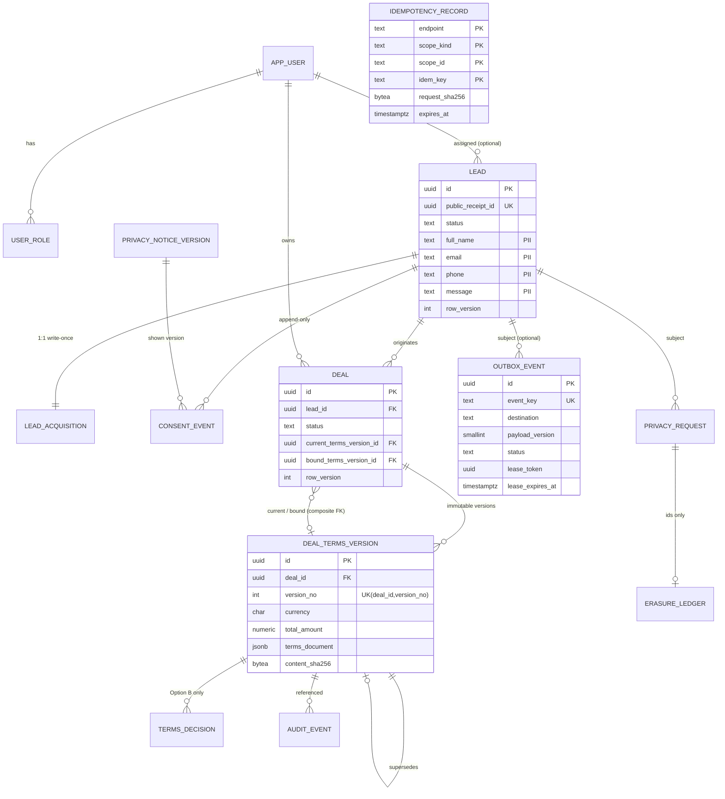

### 3.2 Data dictionary

ทุก timestamp เป็น `timestamptz` ใช้เวลาฐานข้อมูล (`now()`) ในการตัดสิน lease/TTL ไม่ใช้นาฬิกาของ worker

**`lead`** (mutable, ที่เดียวที่เก็บ PII ของผู้ติดต่อ)

| Column | Type | Null | หมายเหตุ |
|---|---|---|---|
| id | uuid PK | N | ใช้ภายในเท่านั้น ไม่คืนให้ anonymous |
| public_receipt_id | uuid UK | N | อ้างอิงใน acknowledgment; ไม่มี endpoint ใดใช้ค่านี้อ่านข้อมูล |
| status | text CHECK | N | `new, contacted, qualified, disqualified, converted, erased` — ชุดสถานะเป็น [P] รอฝ่ายขาย |
| assigned_user_id | uuid FK app_user | Y | ใช้ใน record-level authz |
| full_name, email, phone, message | text | Y | PII; message ≤ 4000 ตัวอักษร [P] |
| locale | text CHECK th/en | Y | |
| possible_duplicate_of | uuid FK lead | Y | soft dedupe เมื่อ idempotency หมดอายุ; ไม่ merge อัตโนมัติ |
| erased_at | timestamptz | Y | CHECK: status `erased` ⇒ PII ทุกช่องเป็น NULL |
| row_version | int | N | optimistic concurrency ของการแก้ lead |

**`lead_acquisition`** (1:1, write-once ที่ระดับแอป; ยกเว้น privacy erasure ล้าง `claimed_source`)

| Column | Type | หมายเหตุ |
|---|---|---|
| lead_id | uuid PK/FK | 1:1 บังคับด้วย PK |
| channel | text | server กำหนดจาก route ที่รับ ไม่ใช่ค่าที่ client ส่ง |
| claimed_source | jsonb | utm/referrer ที่ client อ้าง — **ไม่ใช่การยืนยัน campaign** |
| verified_campaign_ref, verification_method | text | ต้องมาคู่กัน (CHECK) และใส่เมื่อยืนยันกับแหล่งที่เชื่อถือได้เท่านั้น |

**`consent_event`** (append-only) — `lead_id, purpose, legal_basis, event_type(granted/withdrawn/not_given), notice_version_id, source, recorded_by_user_id, occurred_at` + view `consent_current` (แถวล่าสุดต่อ lead+purpose) — รายการ purpose/legal basis **[OD-07]**

**`privacy_notice_version`** (immutable) — `version_label, locale, content_sha256, published_at`, UK(version_label, locale)

**`deal`** (mutable แต่ guard หลัง bound; ห้าม DELETE)

| Column | หมายเหตุ |
|---|---|
| status | `draft, terms_proposed, bound, cancelled` — นิยาม "bound" = binding ตามที่เจ้าของกำหนด **[OD-04]** |
| current_terms_version_id | composite FK `(id, current_terms_version_id)` → `deal_terms_version(deal_id, id)` กัน version ข้าม deal |
| bound_terms_version_id, bound_at, bound_by_user_id | CHECK: `status='bound'` ⇔ ทั้งสามไม่เป็น NULL |
| row_version | trigger เพิ่มทุก UPDATE; ใช้ใน `If-Match` |

**`deal_terms_version`** (immutable: ไม่มี `updated_at`, trigger ปฏิเสธ UPDATE/DELETE)

| Column | หมายเหตุ |
|---|---|
| version_no | UK(deal_id, version_no); แอปกำหนด `max+1` ใน tx ที่ lock deal row |
| supersedes_version_id | composite FK ภายใน deal เดียวกัน |
| currency | `char(3)` ISO-4217 pattern; ชุดสกุลเงินที่อนุญาต **[OD-04]** |
| total_amount | `numeric` ไม่กำหนด scale เพราะยังไม่รู้สกุลเงิน; scale/rounding ตรวจที่แอป **[OD-04]** |
| terms_document | jsonb; ค่าเงินภายในเก็บเป็น **string decimal** (กัน JSON number → float) |
| content_sha256 | hash ของ canonical JSON ของ terms ใช้ตรวจว่า UI แสดง/ผูกฉบับเดียวกัน |

**`audit_event`** (append-only + ห้าม TRUNCATE) — `actor_type, actor_user_id, action, entity_type, entity_id, terms_version_id, request_id, details` — **details ห้ามมี PII** อ้างด้วย id

**`idempotency_record`** — PK `(endpoint, scope_kind, scope_id, idem_key)`; `request_sha256`, `resource_type`, `resource_id` (ภายใน), `response_status`, `expires_at`; ไม่เก็บ payload; `scope_id` เป็น HMAC ไม่ใช่ session id ดิบ

**`outbox_event`** — ดู §5; mutable โดยเจตนา (เป็น work queue ไม่ใช่ audit)

**`privacy_request`**, **`erasure_ledger`** (ids เท่านั้น, append-only, ไม่มี FK เพื่อใช้กับฐานที่ restore)

**`app_user`, `user_role`** — role เป็น text ไม่ใช่ enum เพราะชุดบทบาทยังเป็นข้อเสนอ

### 3.3 Constraints และ indexes ที่สำคัญ

| ความต้องการ | Constraint / index |
|---|---|
| lead 1 รายการมี acquisition 1 รายการ | `lead_acquisition.lead_id` PK + FK |
| key ซ้ำในขอบเขตเดียวกันมีได้แถวเดียว | PK `idempotency_record(endpoint, scope_kind, scope_id, idem_key)` |
| เลข version ไม่ซ้ำภายใน deal | UK `(deal_id, version_no)` |
| deal ชี้ได้เฉพาะ version ของตัวเอง | UK `(deal_id, id)` + composite FK DEFERRABLE |
| event ปลายทางไม่ซ้ำ | UK `outbox_event.event_key` |
| สถานะ processing ต้องมี lease | CHECK `(status='processing') = (lease_token IS NOT NULL AND lease_expires_at IS NOT NULL)` |
| อนุมัติครั้งเดียวต่อ version (Option B) | partial UK `terms_decision(terms_version_id) WHERE decision='approved'` |
| คิว outbox | partial index `(next_attempt_at) WHERE status='pending'`, `(lease_expires_at) WHERE status='processing'` |
| รายการ lead ของ agent | `(assigned_user_id, status, created_at DESC)` |
| purge idempotency | `(expires_at)` |
| soft dedupe | `lower(email)` partial |

### 3.4 แยก immutable terms ออกจาก approval lifecycle — เปรียบเทียบทางเลือก

| | Option A: version immutable + lifecycle บน `deal` | Option B: A + `terms_decision` append-only | Option C: สถานะอนุมัติเป็นคอลัมน์บน `deal_terms_version` |
|---|---|---|---|
| โครงสร้าง | `deal_terms_version` ห้ามแก้; `deal.current_terms_version_id`, `deal.bound_terms_version_id`, `row_version` | เพิ่มตาราง event การตัดสินใจต่อ version | `deal_terms_version.status` = draft/approved/rejected |
| ความ immutable ของ terms | เต็ม | เต็ม | **แตก** — ต้อง UPDATE แถว terms เพื่อเปลี่ยนสถานะ ขัดกับข้อกำหนด "ห้าม generic update flow ขัด immutability" |
| รองรับ maker-checker / หลายผู้อนุมัติ | ไม่รองรับ (ผู้มีสิทธิ์ bind คือผู้อนุมัติ) | รองรับ; ประวัติครบ | รองรับแบบจำกัด ประวัติหาย |
| จำนวนตาราง/โค้ด | น้อยสุด | +1 ตาราง +1 trigger | น้อย แต่ต้องมี trigger ยกเว้นคอลัมน์ ซับซ้อนและเปราะ |
| เหมาะเมื่อ | เจ้าของไม่มีขั้นอนุมัติแยก หรือยังไม่ตัดสิน | เจ้าของยืนยันว่ามีผู้อนุมัติแยกจากผู้ร่าง | ไม่แนะนำ |

**ข้อเสนอ:** เริ่มด้วย **Option A** เป็น baseline และ **ไม่สร้างตาราง approval** จนกว่า OD-04 ยืนยันว่ามีขั้นอนุมัติ ถ้ายืนยัน ให้เพิ่ม Option B เป็น migration แบบเพิ่มอย่างเดียว (additive) ไม่ต้องแก้ข้อมูลเดิม ปฏิเสธ Option C

### 3.5 Enforcement: ฐานข้อมูล vs แอป

| กฎ | ฐานข้อมูล | แอป |
|---|---|---|
| terms/audit/consent/notice immutable | trigger `reject_mutation()` + REVOKE UPDATE/DELETE/TRUNCATE จาก role แอป + role แอปไม่เป็นเจ้าของตาราง | ไม่มี repository method update/delete สำหรับตารางเหล่านี้; ORM model เป็น insert-only; ไม่มี `updated_at` auto-touch |
| binding ผูก version ที่ตรงและยังไม่ stale | conditional UPDATE (`row_version`, `current_terms_version_id`, `status`) + composite FK + CHECK + guard trigger หลัง bound | ตรวจสิทธิ์ (role + record) และ business rule ของ OD-04; แปล 0 แถวเป็น 409 |
| idempotency | PK + `ON CONFLICT` | คำนวณ canonical hash, เลือก scope, ตัดสิน replay/409 |
| lead+acquisition+consent+outbox atomic | transaction เดียว + FK | ห้ามเรียก network ใน transaction |
| record-level authz | (ทางเลือก) Row-Level Security เป็นชั้นสอง — ADR ไม่บังคับ เพราะเพิ่มความซับซ้อนกับ connection pooling | **ชั้นหลัก**: policy function ทุก route/API/replay |
| เงิน | `numeric`, CHECK ≥ 0 | parse เป็น decimal จาก string; ห้าม float ใน JSON boundary; rounding ตาม OD-04 |
| PII ไม่อยู่ใน audit/outbox ที่ไม่จำเป็น | ไม่บังคับได้ทั้งหมดที่ DB | whitelist serializer; test ตรวจ key ที่ไม่อนุญาต |

ข้อจำกัดที่ต้องรู้: trigger และ REVOKE ไม่กัน superuser/เจ้าของฐาน ถ้าต้องการ tamper-evidence ต่อผู้ดูแลระบบ ให้พิจารณา hash chain ใน `audit_event` + ส่งสำเนา digest ออกนอกระบบ (Low, §11.2 L-02)

### 3.6 เงิน

- DB: `numeric`; JSON API: ส่ง/รับเป็น string `"1000.10"`; แอป: ชนิด decimal ของภาษา
- currency, scale ต่อสกุล, rounding mode, ค่าธรรมเนียม และสูตร **รอ OD-04** — ห้ามใส่ค่าเริ่มต้นทางธุรกิจ
- ทดสอบที่ boundary: JSON parse/serialize, DB round-trip, การแสดงผล (ไม่ใช่เฉพาะชนิดคอลัมน์) [E: SRC-08 v1.2]

### 3.7 `updated_at` และ generic update flow

- ตาราง immutable ไม่มี `updated_at` เลย เพื่อไม่ให้ ORM/hook ทั่วไปพยายาม UPDATE
- ตาราง mutable (`lead`, `deal`, `outbox_event`, `app_user`) มี `updated_at`; ของ `deal` ตั้งโดย trigger พร้อม `row_version`
- ห้ามมี "generic PATCH ทุกตาราง" หรือ admin CRUD ที่ครอบตาราง immutable; admin tooling ต้อง allowlist ตาราง

### 3.8 หลักฐานที่รันจริง: smoke test ของ DDL

รันเมื่อ 2026-10-10 ด้วย [`schema/run-smoke-test.sh`](schema/run-smoke-test.sh) บน PostgreSQL 16.15 (cluster ชั่วคราว ลบหลังรัน, fixtures ติดป้าย TEST) ผลดิบ: [`verification/smoke-test-raw-output.md`](verification/smoke-test-raw-output.md)

| Test | สิ่งที่ตรวจ | ผลที่สังเกต |
|---|---|---|
| T01 | lead+acquisition+consent+outbox+idempotency ใน tx เดียว | commit, leads=1 |
| T02 | acquisition ละเมิด CHECK | ERROR, leads ยังเป็น 1 (rollback) |
| T03 | key ซ้ำ payload ต่าง | `ON CONFLICT DO NOTHING` คืน 0 แถว; hash เดิมตรง payload แรก ไม่ตรง payload ใหม่ |
| T04 | key หมดอายุ | takeover แบบ atomic สำเร็จเฉพาะแถว `expires_at <= now()` |
| T05 | UPDATE/DELETE terms version | ERROR append-only ทั้งสอง |
| T06 | deal ชี้ version ของ deal อื่น | ERROR composite FK |
| T07/T08 | bind ด้วย version เก่า / row_version เก่า | 0 แถว ทั้งคู่ |
| T09 | bind ถูกต้อง + audit | 1 แถว, row_version 2→3 |
| T10 | เปลี่ยน version หลัง bound | ERROR guard |
| T11 | UPDATE/DELETE audit | ERROR ทั้งสอง |
| T12 | worker A lease หมด → heartbeat A, reclaim (provider ไม่ idempotent), ack A | heartbeat 0 แถว; reclaim ย้ายเป็น `uncertain`; ack A 0 แถว |
| T13 | provider idempotent: reclaim หมุน token | ack token เก่า 0 แถว; ack token ใหม่สำเร็จ |
| T14 | ถอน consent | outbox pending ของ purpose นั้น → `cancelled` ใน tx เดียว; `consent_current` = withdrawn |
| T15 | erased แต่ยังมี PII | ERROR CHECK; erase ที่ล้าง PII สำเร็จ |
| T16 | DELETE deal | ERROR |
| C01 | 2 sessions insert idempotency key เดียวกันพร้อมกัน | session 2 รอ ~2.0s จน session 1 commit แล้วได้ 0 แถว; มี 1 แถวต่อ key |
| C02 | 2 workers claim พร้อมกันด้วย `FOR UPDATE SKIP LOCKED` | 15 / 5 / overlap 0 |

**Diagrams:** render ทั้ง 12 diagrams ในเอกสารนี้ด้วย `@mermaid-js/mermaid-cli@11.4.2` + Chromium headless สำเร็จ 12/12 (รอบแรกพบ parse error ใน S2 จาก `;` ในข้อความ แก้แล้ว) — ตรวจ syntax/การแสดงผล ไม่ได้ตรวจความถูกต้องของเนื้อหา

**ขอบเขตของหลักฐานนี้:** พิสูจน์พฤติกรรม SQL ของแบบที่เสนอบน PG16 เท่านั้น ไม่ใช่ application test, ไม่ใช่ load test, ไม่ได้ทดสอบกับ hosting/connection pooler จริง และไม่ได้รันบนฐานข้อมูลของโครงการ

---

## 4. Transactions และ concurrency

### 4.1 Idempotency specification

| หัวข้อ | ข้อกำหนด [P] |
|---|---|
| Key | header `Idempotency-Key` 16–128 ตัวอักษร; ฟอร์ม public สร้าง key ตอน render และใช้ซ้ำเมื่อ retry |
| Scope | `(endpoint, scope_kind, scope_id, idem_key)`; `scope_kind = user` → `scope_id = user id`; `scope_kind = anonymous_session` → `scope_id = HMAC(server_secret, nonce ของ signed form token)` |
| Signed form token | server ออกตอน GET หน้าแบบฟอร์ม: nonce + issued_at + HMAC; อายุ [P] 2 ชั่วโมง; ไม่มี token ที่ถูกต้อง → 400 (ใช้เป็น anti-automation ชั้นหนึ่งด้วย) |
| Payload hash | SHA-256 ของ canonical JSON (เรียง key, normalize Unicode NFC, trim, ตัด field ที่ server สร้าง) |
| TTL | `expires_at = created_at + TTL`; TTL [P] 24 ชั่วโมงทั้ง public และ private mutation — เป็นค่าทางวิศวกรรม เปลี่ยนได้; เก็บเฉพาะ hash จึงไม่มี payload ส่วนบุคคล แต่ `scope_id` ยังผูกกับ session จึงอยู่ใน data map **[OD-08 retention]** |
| การจัดการ TTL | (1) ทุก lookup ใช้ `expires_at > now()` — ไม่พึ่งเวลาที่ purge; (2) insert ใช้ `ON CONFLICT … DO UPDATE … WHERE expires_at <= now()` เพื่อ takeover แถวหมดอายุแบบ atomic (T04); (3) purge job ลบ `expires_at < now() - 1 day` เป็น batch ≤ 1,000 แถว รันโดย runtime เดียวกับ dispatcher |
| หลังหมดอายุ | คำขอถือเป็นคำขอใหม่ → อาจเกิด lead ซ้ำ → ระบบตั้ง `possible_duplicate_of` เมื่อ normalized email/phone ตรงกับ lead ภายในหน้าต่างเวลา **[OD-08]**; ไม่ merge อัตโนมัติ, ไม่ปฏิเสธคำขอ |
| In-progress state | ไม่จำเป็นใน v2.1 เพราะ idempotency row ถูก insert ใน **transaction เดียวกับ** ผลลัพธ์ทั้งหมด; คำขอที่สองจะรอ unique index จนรายการแรก commit/rollback (C01) — ถ้าอนาคตมี operation หลาย transaction ต้องเพิ่มสถานะ in-progress |
| Anonymous replay | key เดิม + hash เดิม → `202` body เดียวกับครั้งแรก: `{"status":"received","receipt_ref":"<public_receipt_id>"}` — ไม่มี lead id, ไม่มีข้อมูลที่ส่งมา, ไม่มี endpoint ใดใช้ `receipt_ref` อ่านข้อมูล |
| Authenticated replay | key เดิม + hash เดิม → ตรวจสิทธิ์ **ปัจจุบัน** ของผู้เรียกต่อ `resource_id`; ผ่าน → คืน representation ปัจจุบัน (ไม่ใช่ snapshot เก่า) + header `Idempotent-Replayed: true`; ไม่ผ่าน → `404` (ไม่ยืนยันการมีอยู่) |
| Payload conflict | key เดิม + hash ต่าง → `409 {"error":"idempotency_key_reused"}` ไม่มีรายละเอียดของคำขอเดิม |

### 4.2 S1 — Lead + acquisition + consent + outbox ใน transaction เดียว

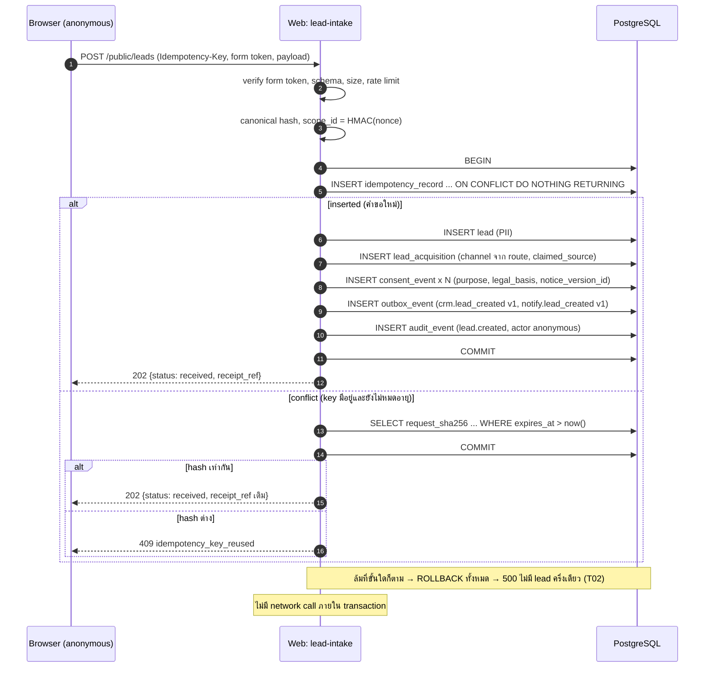

### 4.3 S2 — Concurrent duplicate และ payload conflict

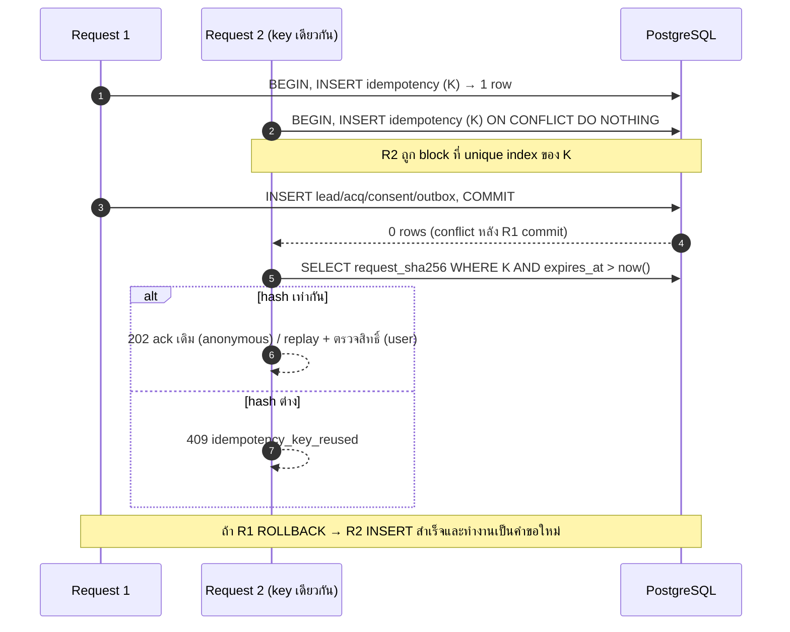

หลักฐาน: C01 (§3.8) แสดงการ block และผล 0 แถวจริง

### 4.4 S3 — Approval/binding และ stale version

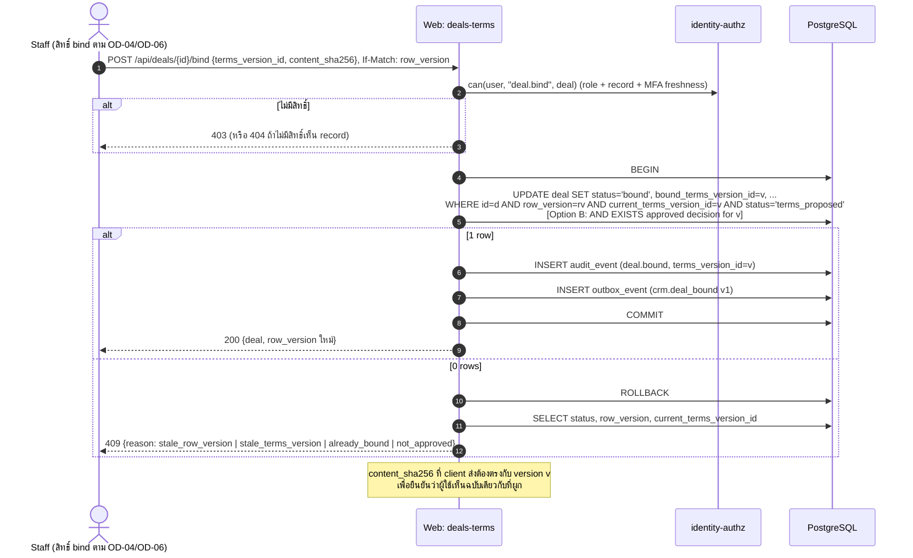

หลักฐาน: T07–T10 (§3.8) การสร้าง terms version ใหม่ใช้ `SELECT … FOR UPDATE` บน deal row เพื่อกำหนด `version_no` แล้ว UPDATE `current_terms_version_id` ใน tx เดียว

### 4.5 S4 — CRM ล่ม

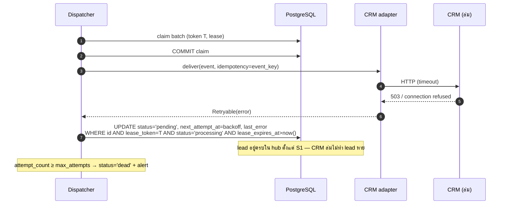

### 4.6 S5 — Worker crash/reclaim

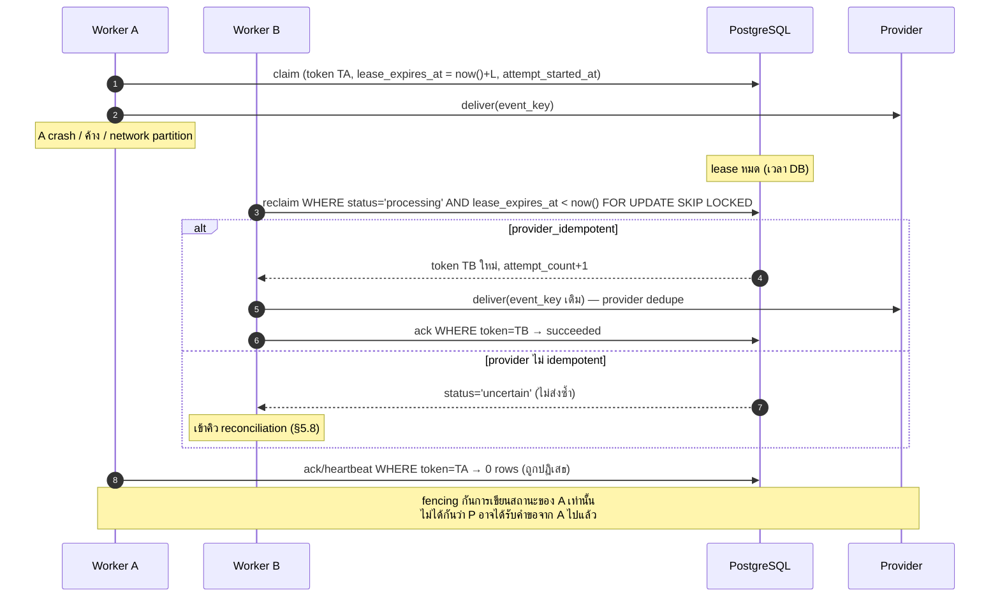

หลักฐาน: T12, T13, C02 (§3.8)

### 4.7 S6 — Provider timeout ที่ผลไม่แน่นอน

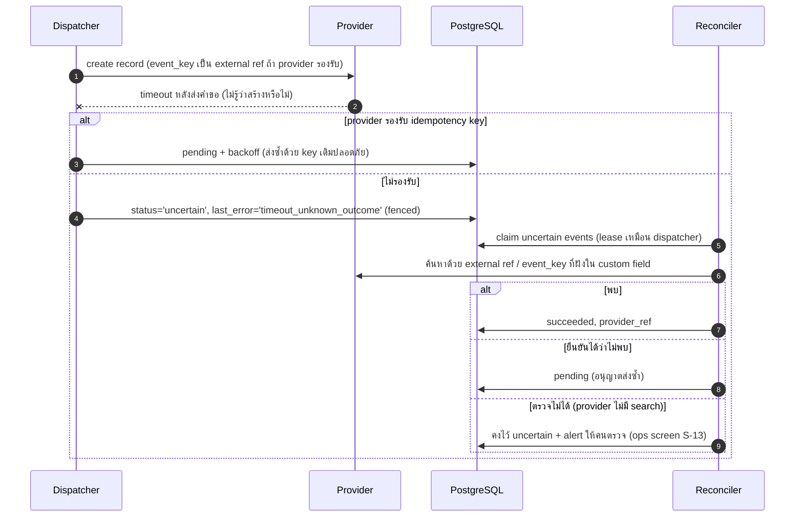

### 4.8 สรุป transaction boundaries, locking และผลตอบกลับ

| Flow | Transaction | Lock / concurrency | ผลตอบกลับ |
|---|---|---|---|
| S1 intake | 1 tx: idempotency + lead + acquisition + consent + outbox + audit | unique index ของ idempotency | 202 ack / 202 ack ซ้ำ / 409 / 400 / 429 / 500 |
| สร้าง terms version | 1 tx: lock deal row `FOR UPDATE` → insert version (max+1) → update current → audit | row lock | 201 / 409 (deal bound/cancelled) / 403 |
| S3 bind | 1 tx: conditional UPDATE → audit → outbox | optimistic (`row_version`) + conditions | 200 / 409 reason / 403 / 404 |
| claim | 1 tx สั้น: `UPDATE … WHERE id IN (SELECT … FOR UPDATE SKIP LOCKED LIMIT n)` | SKIP LOCKED | — |
| deliver | **ไม่มี** DB transaction ระหว่าง network call | lease + token | — |
| ack/fail/heartbeat | 1 statement fenced | token + lease ยังไม่หมด (`now()` ของ DB) | 0 แถว = stale → ทิ้งผล log warning |
| ถอน consent | 1 tx: consent_event → cancel pending outbox → enqueue suppression → audit | — | 200 |

---

## 5. Outbox

### 5.1 State machine

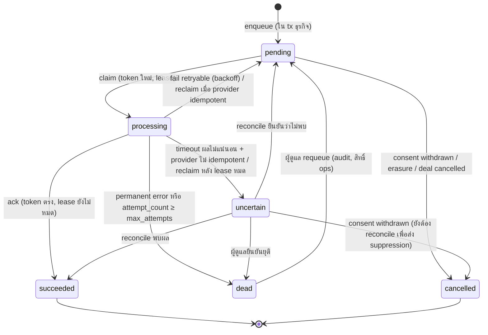

Terminal: `succeeded`, `cancelled`; `dead` เป็น terminal จนกว่าคน requeue

### 5.2 Atomic claim (ข้อเสนอ SQL)

```sql
UPDATE acs.outbox_event
SET status = 'processing', lease_token = gen_random_uuid(),
    lease_expires_at = now() + make_interval(secs => :lease_secs),
    attempt_count = attempt_count + 1, attempt_started_at = now(), updated_at = now()
WHERE id IN (
  SELECT id FROM acs.outbox_event
  WHERE status = 'pending' AND next_attempt_at <= now()
  ORDER BY next_attempt_at
  FOR UPDATE SKIP LOCKED
  LIMIT :batch)
RETURNING id, event_key, destination, event_type, payload_version, payload, lease_token;
```

Reclaim ของ `processing` ที่ lease หมดเป็น statement แยก (T12): provider idempotent → หมุน token แล้วส่งซ้ำ; ไม่ idempotent → `uncertain`

### 5.3 Lease, heartbeat และ fencing

- `lease_secs` [P] = provider timeout × 2 + 10 วินาที (เช่น timeout 10s → lease 30s); delivery ที่นานกว่านั้นใช้ heartbeat ขยาย lease
- heartbeat/ack/fail ทุกคำสั่งมีเงื่อนไข `id = :id AND lease_token = :token AND status = 'processing' AND lease_expires_at > now()` — ใช้เวลาฐานข้อมูล
- worker ที่ lease หมด **ก่อน** มีคน reclaim ก็ถูกปฏิเสธ (T12 heartbeat 0 แถว) ไม่ใช่ถูกปฏิเสธเฉพาะหลัง reassignment
- claim/reclaim หมุน token เสมอ
- **ข้อจำกัด:** fencing ป้องกันการเขียนสถานะโดย worker เก่า แต่**ไม่รับประกันว่า external effect จะไม่ซ้ำ** — worker เก่าอาจส่งคำขอถึง provider ไปแล้ว การกันซ้ำที่ปลายทางมาจาก provider idempotency (`event_key`) หรือ reconciliation เท่านั้น

### 5.4 Retry/backoff และ terminal

| ประเภทผล | ตัวอย่าง | การจัดการ |
|---|---|---|
| Succeeded | 2xx + ref | `succeeded`, เก็บ `provider_ref` |
| Retryable | 429, 5xx, connection refused ก่อนส่ง | `pending`, `next_attempt_at = now() + min(cap, base × 2^(attempt-1)) × jitter(0.8–1.2)`; [P] base 30s, cap 1h, `max_attempts` 8 (≈ 2–3 ชั่วโมงรวม) — เคารพ `Retry-After` |
| Uncertain | timeout หลังส่ง, connection reset ระหว่างอ่าน response | provider idempotent → retryable; ไม่ idempotent → `uncertain` |
| Permanent | 400/422 validation, 401/403 credential ผิด | `dead` + alert ทันที (credential ผิดกระทบทุก event → alert ระดับสูง) |

### 5.5 Runtime เจ้าของ scheduling/retry

- **เจ้าของเดียว:** dispatcher module ใน codebase เดียวกัน อ่าน/เขียนสถานะใน `outbox_event` เท่านั้น — **ADR-03**
- รูปแบบ runtime ขึ้นกับ hosting **[OD-05]**: (a) long-running worker process หรือ (b) scheduled batch ที่ platform เรียกเป็นรอบ (bounded batch, ต้องจบก่อน function timeout, ป้องกัน overlap ด้วย SKIP LOCKED + lease)
- n8n หรือ integration platform อื่น (ถ้าเลือกใช้): เป็น **ปลายทาง** ไม่ใช่ scheduler — รับ `event_key`, ปิด retry ภายใน n8n หรือกำหนดเป็น 0, คืนผลสำเร็จ/ล้มแบบ synchronous ให้ dispatcher ตัดสิน
- ห้าม web request ส่งงานภายนอกเอง (fire-and-forget)

### 5.6 Event catalog แยกตามปลายทาง

| event_type (destination) | payload_version | Field whitelist [P] | consent_purpose | provider_idempotent | สถานะ |
|---|---|---|---|---|---|
| `lead_created` (crm) | 1 | `lead_ref`, `created_at`, `channel`, `locale`, `full_name`, `email`, `phone`, `message`, `consents[] {purpose, granted}` | follow-up purpose **[OD-07]** | ตาม provider **[OD-09]** | field PII ต้อง DPO ยืนยัน |
| `lead_created` (notify) | 1 | `lead_ref`, `channel`, `created_at`, `hub_url` — **ไม่มี PII** | — | ใช่ถ้ามี dedupe key; ถ้าไม่มี ผลซ้ำยอมรับได้ (แจ้งเตือนภายใน) | [P] |
| `deal_bound` (crm) | 1 | `deal_ref`, `lead_ref`, `terms_version_ref`, `version_no`, `currency`, `total_amount` (string), `bound_at` | — | **[OD-09]** | รอ OD-04 |
| `subject_suppression` (crm) | 1 | `lead_ref`, `provider_ref`, `action` (`withdraw:<purpose>` / `erase`) | — (ส่งเสมอเมื่อมีคำขอ) | **[OD-09]** | [P] |
| `briefing_requested` (ai) | 1 | `lead_ref`, `message_redacted`, `locale`, `channel` | AI purpose **[OD-07/OD-11]** | n/a | OPTIONAL ปิดค่าเริ่มต้น |
| `lilith.*` | — | ยังไม่กำหนด | — | — | **CONDITIONAL** (D-05/D-06) |

กฎ: เพิ่ม/ลด field = เพิ่ม `payload_version`; adapter รองรับ version เก่าจนคิวว่าง; test ตรวจว่า payload มีเฉพาะ key ใน whitelist

### 5.7 Alerts [P]

| สัญญาณ | เงื่อนไข (ค่าเริ่มต้นปรับได้) | ระดับ |
|---|---|---|
| Outbox lag | `min(next_attempt_at)` ของ pending เก่ากว่า 15 นาที | Warning |
| Dead events | > 0 ใน 1 ชั่วโมง | High |
| Uncertain events | > 0 ค้างเกิน 1 ชั่วโมง | High |
| Credential error | 401/403 จาก provider | Critical |
| Dispatcher heartbeat | ไม่มี claim cycle เกิน 3 รอบ | High |
| Idempotency purge | แถวหมดอายุค้าง > 2 วัน | Low |

### 5.8 Reconciliation

1. **Uncertain queue** (event-level) — ตามแผนภาพ S6; ใช้ lease/token เดียวกับ dispatcher
2. **Periodic sweep** (aggregate-level) [P] วันละครั้ง: lead ที่สร้างใน 48 ชั่วโมงที่มี `crm.lead_created` succeeded ต้องพบใน CRM ด้วย external ref; ไม่พบ → สร้าง incident ไม่ส่งซ้ำอัตโนมัติ
3. **Suppression check** — หลังถอน consent/erasure ตรวจว่า CRM สถานะ suppressed/deleted จริง
4. ผล reconciliation เขียน `audit_event` (actor `worker`)

---

## 6. Authorization และ security

### 6.1 Role / action / record matrix (ข้อเสนอ — รอเจ้าของยืนยัน OD-06)

บทบาทที่เสนอ: **OA** owner-admin, **SM** sales manager, **SA** sales agent, **AU** auditor (อ่านอย่างเดียว), **DPO** privacy officer, **PT** partner (ปิดค่าเริ่มต้น), **AN** anonymous

| Action | AN | SA | SM | OA | AU | DPO | PT | Record rule |
|---|---|---|---|---|---|---|---|---|
| ส่ง lead (public) | ✓ | – | – | – | – | – | – | rate limit + form token |
| ดูรายการ lead | – | ✓ | ✓ | ✓ | ✓ | ✓ | – | SA: เฉพาะ `assigned_user_id = self`; อื่น: ทั้งหมด |
| ดู PII ของ lead | – | ✓ | ✓ | ✓ | masked | ✓ | – | AU เห็นแบบ mask |
| มอบหมาย lead | – | – | ✓ | ✓ | – | – | – | |
| แก้สถานะ lead | – | ✓ | ✓ | ✓ | – | – | – | SA เฉพาะที่ได้รับมอบหมาย |
| สร้าง deal | – | ✓ | ✓ | ✓ | – | – | – | จาก lead ที่ตนเข้าถึงได้ |
| สร้าง terms version | – | ✓ | ✓ | ✓ | – | – | – | deal ที่ตนเป็น owner หรือ SM/OA; deal ไม่ bound |
| อนุมัติ terms (Option B) | – | – | ✓ | ✓ | – | – | – | maker ≠ checker **[OD-04]** |
| Bind deal | – | **[OD-04]** | ✓ | ✓ | – | – | – | MFA ภายใน 15 นาที [P] |
| ยกเลิก deal | – | – | ✓ | ✓ | – | – | – | ก่อน bound เท่านั้น (หลัง bound รอ OD-04) |
| ดู audit | – | own | ✓ | ✓ | ✓ | ✓ | – | |
| จัดการผู้ใช้/บทบาท | – | – | – | ✓ | – | – | – | MFA ล่าสุด; audit |
| จัดการ privacy request / erasure | – | – | – | ✓ | – | ✓ | – | สองคนยืนยัน erasure [P] |
| Export ข้อมูลเจ้าของข้อมูล | – | – | – | – | – | ✓ | – | |
| Outbox ops (requeue/resolve uncertain) | – | – | – | ✓ | – | – | – | ดู payload ได้เฉพาะ OA/DPO |
| ดู deal ที่แชร์ | – | – | – | – | – | – | **[OD-06]** | field whitelist; ไม่มี PII ข้ามองค์กร |

### 6.2 Authorization rules

- **Server-side ทุก private route และ API** ผ่าน policy function เดียว `can(actor, action, record)`; UI ซ่อนปุ่มเป็นแค่ UX
- record ที่ผู้ใช้ไม่มีสิทธิ์เห็น → `404` (ไม่ยืนยันการมีอยู่); เห็นแต่ทำ action ไม่ได้ → `403`
- **Replay ของ idempotency ตรวจสิทธิ์ปัจจุบัน** (§4.1)
- รายการ (list) กรองที่ query ด้วยเงื่อนไขสิทธิ์ ไม่ใช่กรองหลังดึง
- export/report ใช้ policy เดียวกัน

### 6.3 Controls

| หัวข้อ | ข้อกำหนด [P] |
|---|---|
| Authentication | ใช้ auth provider เดิมของ repo ถ้าผ่าน (OD-02); session cookie `HttpOnly; Secure; SameSite=Lax`; idle timeout และ absolute timeout ตาม OD-06 |
| MFA | บังคับทุกบทบาท staff (SA/SM/OA/AU/DPO); step-up สำหรับ bind, จัดการบทบาท, erasure, export |
| CSRF / origin | cookie-authenticated mutation ทุกตัว: ตรวจ `Origin`/`Sec-Fetch-Site` + CSRF token; public intake ใช้ signed form token + origin check |
| Abuse controls | rate limit ต่อ IP และต่อ form token; payload ≤ 16 KB [P]; honeypot field; CAPTCHA/challenge เป็นตัวเลือกเมื่อพบการโจมตี (provider รอ OD-09) |
| Validation | schema validation ทุก endpoint; ปฏิเสธ field ที่ไม่รู้จัก |
| Output | escape ทุกข้อความที่มาจาก lead/AI; CSP ไม่มี inline script |
| Secrets | runtime credentials ของ hosting เท่านั้น; ไม่อยู่ใน repo/log; rotate เมื่อมีผู้ออก |
| Logs | structured, อ้าง lead/event id; ไม่มี PII, token, secret; retention **[OD-08]** |
| Private responses | `Cache-Control: private, no-store`; `Vary: Cookie`; ไม่ผ่าน shared/CDN cache |
| Login + private pages | `<meta name="robots" content="noindex">` + `X-Robots-Tag: noindex`; **ไม่อยู่ใน sitemap**; login ไม่แสดงข้อมูลส่วนตัว |
| robots.txt / noindex | **ไม่ใช่ access control** — ใช้เพียงลดการทำดัชนี การป้องกันจริงคือ authn/authz ฝั่ง server |

### 6.4 Threat model (STRIDE)

| ID | Threat | ตัวอย่าง | Control | ทดสอบ |
|---|---|---|---|---|
| T-S1 | Spoofing | เข้าสู่ระบบด้วยรหัสที่รั่ว | MFA, rate limit login, แจ้งเตือน login ใหม่ | AT-SEC-01 |
| T-S2 | Spoofing | อ้าง campaign ปลอมใน utm | เก็บเป็น `claimed_source`; verified เฉพาะแหล่งที่เชื่อถือได้ | AT-LD-03 |
| T-T1 | Tampering | แก้ terms หลังผูก | immutable + guard + audit (T05, T10) | AT-DL-02 |
| T-T2 | Tampering | worker เก่าเขียนทับสถานะ | fencing token (T12, T13) | AT-OB-02 |
| T-R1 | Repudiation | ปฏิเสธว่าไม่ได้ผูก deal | audit ผูก actor + terms_version + content_sha256 | AT-DL-04 |
| T-I1 | Info disclosure | agent ดู lead คนอื่นด้วย id | record-level authz, 404 | AT-SEC-02 |
| T-I2 | Info disclosure | private page ถูก cache ที่ CDN | `private, no-store` | AT-SEC-04 |
| T-I3 | Info disclosure | idempotency replay คืน lead ให้ anonymous | ack อย่างเดียว | AT-ID-03 |
| T-I4 | Info disclosure | PII ไหลไป Slack/AI/log | whitelist ต่อปลายทาง, notify ไม่มี PII, log scrub | AT-OB-05, AT-PV-05 |
| T-I5 | Info disclosure | ข้อมูลข้ามองค์กร ACS/LILITH/The Middle | ไม่มี integration ใน v2.1; partner ปิด | AT-SEC-06 |
| T-D1 | DoS | spam ฟอร์ม | rate limit, form token, payload limit, honeypot | AT-SEC-05 |
| T-D2 | DoS | provider ช้าทำ worker ค้าง | timeout, lease, batch จำกัด | AT-OB-03 |
| T-E1 | Elevation | SA ผูก deal ที่ต้องอนุมัติ | policy + DB condition (Option B) | AT-DL-03 |
| T-E2 | Elevation | prompt injection ในข้อความ lead | AI ไม่มีเครื่องมือ, output เป็น data (ADR-04) | AT-AI-02 |

---

## 7. Privacy lifecycle

> ส่วนนี้เป็นการออกแบบทางเทคนิค **ไม่ใช่คำแนะนำทางกฎหมาย** ผลทดสอบทางเทคนิคไม่พิสูจน์ว่าปฏิบัติตามกฎหมาย รายการที่ติด **[DPO]** ต้องให้ DPO/ที่ปรึกษากฎหมายยืนยัน

### 7.1 Data map (purpose / legal basis / retention เป็นช่องรอยืนยัน)

| ข้อมูล | แหล่ง | Purpose ที่เสนอ [P] | Legal basis | Retention | ที่เก็บ / ผู้ประมวลผล |
|---|---|---|---|---|---|
| ชื่อ, อีเมล, โทร, ข้อความ | ฟอร์ม public | ติดต่อกลับตามคำขอ | [DPO] | [DPO/OD-08] | `lead`; CRM [OD-09] |
| ช่องทาง/utm/referrer | request | วัดผลช่องทาง | [DPO] | [OD-08] | `lead_acquisition` |
| consent events | ฟอร์ม/คำขอ | หลักฐานความยินยอม | [DPO] | [DPO] | `consent_event` |
| deal + terms | พนักงาน | ทำข้อตกลง | [DPO] | [DPO] (อาจผูกกฎหมายบัญชี/สัญญา) | `deal`, `deal_terms_version` |
| audit | ระบบ | ความรับผิดชอบ/ความปลอดภัย | [DPO] | [OD-08] | `audit_event` |
| session/scope HMAC | ระบบ | กันส่งซ้ำ | [DPO] | TTL 24h + purge | `idempotency_record` |
| logs | ระบบ | ปฏิบัติการ | [DPO] | [OD-08] | hosting [OD-05] |
| ข้อความที่ redact แล้ว (ถ้าเปิด AI) | lead | สรุปให้พนักงาน | [DPO] | ไม่เก็บที่ provider ถ้าเลือกได้ | AI provider [OD-11] |

การโอนข้อมูลข้ามประเทศ (hosting region, CRM, AI provider) **[DPO]** ผูกกับ ADR-01

### 7.2 Consent capture

- บันทึก `consent_event` แยกต่อ purpose พร้อม `notice_version_id` ใน transaction เดียวกับ lead (S1)
- purpose ที่ไม่บังคับ: checkbox ไม่ติ๊กไว้ก่อน (default unchecked) ไม่ผูกกับการส่งฟอร์ม [P] — ตรงกับแนวที่ใช้ใน ACS PDPA task เดิม แต่ต้องยืนยันใหม่สำหรับโครงการนี้
- purpose ที่ใช้ legal basis อื่นที่ไม่ใช่ consent บันทึก `event_type='not_given'` + `legal_basis` ตามที่ DPO กำหนด เพื่อให้ data map ตรวจได้

### 7.3 การถอน consent และหยุดงานที่เกี่ยวข้อง

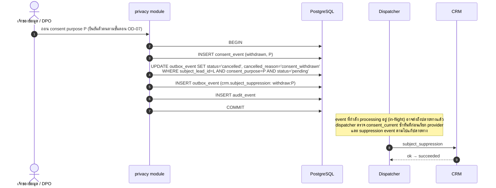

- ทุก dispatch ของ event ที่มี `consent_purpose` ตรวจ `consent_current` **ก่อนเรียก provider**; ถ้าถอนแล้ว → `cancelled` (fenced)
- `uncertain` events ของ purpose ที่ถูกถอน: ไม่ส่งซ้ำ แต่ยัง reconcile เพื่อรู้ว่าต้อง suppress ที่ปลายทางหรือไม่
- หลักฐาน: T14 (§3.8)

### 7.4 สิทธิของเจ้าของข้อมูล

| สิทธิ | การออกแบบ [P] | ข้อที่ต้องยืนยัน |
|---|---|---|
| Access / export | DPO สร้าง export จาก `lead`, `lead_acquisition`, `consent_current`, deal ที่เกี่ยวข้อง (ไม่รวม PII ของบุคคลอื่น) เป็น JSON/CSV; บันทึก audit | รูปแบบ, เวลาตอบ, การยืนยันตัวตน [DPO] |
| Correction | แก้ `lead` (mutable) + audit; terms ที่ bound แล้วไม่แก้ — สร้างบันทึกแก้ไขแยกตามนโยบาย | วิธีแก้ข้อมูลใน terms ที่ผูกแล้ว [DPO/OD-04] |
| Erasure | ดู 7.5 | ข้อยกเว้นการลบ (เช่น ภาระทางสัญญา/กฎหมาย) [DPO] |
| Withdraw consent | 7.3 | |
| Objection / restriction | ตั้งค่าที่ระดับ purpose (เหมือน withdraw) + ระงับการประมวลผลบางส่วน | ขอบเขต [DPO] |

### 7.5 Erasure ครอบคลุมทุกที่เก็บ

| ที่เก็บ | การกระทำ [P] |
|---|---|
| `lead` | NULL ทุก PII, `status='erased'`, `erased_at` (CHECK บังคับ — T15) |
| `lead_acquisition` | ล้าง `claimed_source` (referrer อาจมีข้อมูลระบุตัว) ผ่าน function ของ privacy module เท่านั้น |
| `consent_event` | ไม่มี PII นอกจาก `lead_id`; เก็บเป็นหลักฐานตามที่ DPO กำหนด [DPO] |
| `deal`, `deal_terms_version` | ออกแบบไม่ให้มี PII ของผู้ติดต่อใน terms (อ้าง `lead_id`) — ถ้า OD-04 ต้องมีชื่อคู่สัญญาใน terms ต้องตัดสินว่า erasure มีข้อยกเว้นหรือใช้ crypto-shredding [DPO] |
| `audit_event` | ไม่มี PII ตามกฎ details; ไม่แก้ |
| `outbox_event` | pending → `cancelled`; terminal → แทน payload ด้วย `{"redacted":true}` (outbox mutable โดยเจตนา) |
| ปลายทาง (CRM ฯลฯ) | enqueue `subject_suppression: erase`; reconcile ยืนยัน |
| Logs | ออกแบบไม่ให้มี PII; logs ที่หลุดเข้าไปลบตาม retention ไม่ลบรายแถว [OD-08] |
| Backups | ข้อมูลยังอยู่จนกว่า backup หมดอายุ; `erasure_ledger` (ids) ใช้ re-apply erasure ทันทีหลัง restore — เป็นขั้นบังคับใน restore runbook |
| `idempotency_record` | ไม่มี payload; หมดอายุตาม TTL |

### 7.6 Anonymisation vs pseudonymisation

- หลัง erasure แถว `lead` ยังมี `id`, `public_receipt_id`, timestamps, channel และเชื่อมกับ deal/audit/consent ด้วย id ได้ — นี่คือ **pseudonymisation** ไม่ใช่ anonymisation เพราะยังเชื่อมกลับได้ผ่าน CRM external ref, backups, logs หรือข้อมูลภายนอก
- เอกสารนี้**ไม่อ้าง**ว่าข้อมูลหลัง erasure หมดสถานะข้อมูลส่วนบุคคล ให้ถือเป็นข้อมูลส่วนบุคคลจนกว่าปลายทางลบแล้ว backups หมดอายุ และ DPO ประเมินว่าไม่สามารถระบุตัวได้อย่างสมเหตุสมผล
- รายงานสถิติ (ถ้ามี) ใช้ aggregate ขั้นต่ำตามที่ DPO กำหนด

### 7.7 ข้อที่ต้องให้ DPO/ที่ปรึกษากฎหมายยืนยัน

1. รายการ purpose และ legal basis ต่อ purpose
2. ข้อความ privacy notice TH/EN และการ versioning
3. Retention ต่อประเภทข้อมูล รวม logs, audit, consent proof, backups
4. ขั้นตอนยืนยันตัวตนสำหรับคำขอสิทธิ และกรอบเวลาตอบ
5. ข้อยกเว้นการลบสำหรับ deal/terms ที่ผูกแล้ว
6. การโอนข้อมูลข้ามประเทศ (hosting, CRM, AI) และสัญญาผู้ประมวลผล
7. ฟิลด์ PII ที่อนุญาตส่ง CRM
8. การใช้ AI กับข้อความ lead (ถ้าเปิด)

---

## 8. Prototype contract

> **สถานะ:** ส่วนนี้คือ **contract** (ข้อกำหนดหน้าจอ) ในรูป Markdown screen specifications + low-fidelity text wireframes **ยังไม่มี clickable prototype** ที่สร้างหรือทดลองจริง ผู้สร้างต้นแบบ (เช่น Lovable ตามบทบาทใน SRC-04) ใช้ contract นี้ แล้วส่งลิงก์/commit ที่ทดลองได้เป็นหลักฐาน prototype acceptance แยกต่างหาก

### 8.1 Sitemap

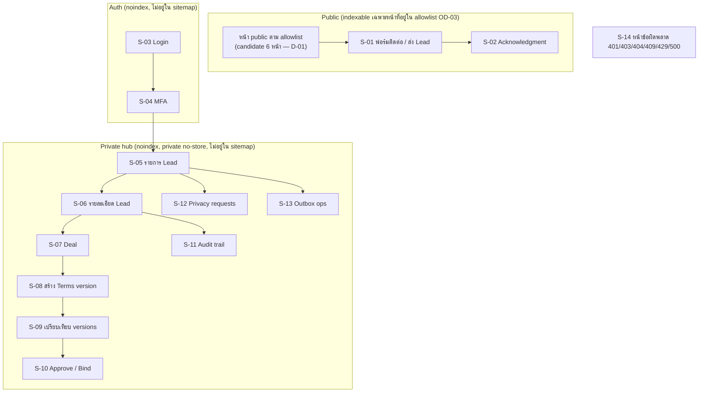

### 8.2 User flows

| Flow | Role | ขั้นตอน |
|---|---|---|
| UF-1 ส่ง Lead | AN | หน้า public → S-01 กรอก + เลือก consent → ส่ง → S-02 (ส่งซ้ำ/refresh ได้ ack เดิม) |
| UF-2 คัด Lead | SA/SM | S-03 → S-04 → S-05 (กรอง) → S-06 → เปลี่ยนสถานะ/มอบหมาย (SM) |
| UF-3 ทำข้อตกลง | SA/SM | S-06 → สร้าง deal (S-07) → S-08 สร้าง v1 → แก้เป็น v2 → S-09 เทียบ |
| UF-4 อนุมัติ/ผูก | SM/OA | S-07 → S-10 ตรวจ content hash + step-up MFA → Bind → ผลสำเร็จหรือ 409 stale |
| UF-5 ถอน consent / erasure | DPO | S-12 รับคำขอ → ยืนยันตัวตน → ดำเนินการ → ติดตามสถานะ suppression |
| UF-6 จัดการ outbox | OA | S-13 ดู dead/uncertain → resolve/requeue พร้อมเหตุผล |

### 8.3 Screen inventory และ states

| Screen | Roles | ข้อมูลหลัก | Loading | Empty | Error | Duplicate | Unauthorized | Stale |
|---|---|---|---|---|---|---|---|---|
| S-01 ฟอร์ม Lead | AN | ชื่อ, ติดต่อ, ข้อความ, consent ต่อ purpose, ลิงก์ notice | ปุ่ม disabled + spinner; กันกดซ้ำ | — | validation inline; 429 ข้อความรอ; 500 ให้ลองใหม่ด้วย key เดิม | ส่งซ้ำ → ไป S-02 ข้อความเดียวกัน | — | form token หมดอายุ → โหลดฟอร์มใหม่ คงข้อมูลที่กรอก |
| S-02 Ack | AN | "ได้รับข้อมูลแล้ว" + receipt_ref | — | — | — | เหมือนเดิมทุกครั้ง | — | — |
| S-03 Login | ทุก staff | — | ✓ | — | ข้อความกลาง ๆ ไม่บอกว่าบัญชีมีอยู่หรือไม่ | — | — | session หมด → กลับ S-03 |
| S-04 MFA | ทุก staff | — | ✓ | — | code ผิด/หมดเวลา | — | — | — |
| S-05 รายการ Lead | SA/SM/OA/AU/DPO | ตาราง: วันที่, ช่องทาง, สถานะ, ผู้รับผิดชอบ, ป้าย possible duplicate | skeleton | "ยังไม่มี Lead" / "ไม่มีผลตามตัวกรอง" | แถบ error + retry | ป้าย "อาจซ้ำ" ลิงก์ไปรายการเดิม | redirect S-03 / S-14 403 | — |
| S-06 รายละเอียด Lead | ตาม matrix | PII (AU เห็น mask), acquisition (แยก claimed/verified), consent ปัจจุบัน, deals, audit ย่อ | ✓ | ไม่มี deal | ✓ | ลิงก์ duplicate | 404 ถ้าไม่มีสิทธิ์เห็น | บันทึกแก้ไขชน row_version → 409 แสดงค่าปัจจุบัน |
| S-07 Deal | ตาม matrix | สถานะ, current/bound version, ประวัติ | ✓ | ยังไม่มี terms | ✓ | — | 403/404 | 409 เมื่อมีคนแก้ก่อน |
| S-08 Terms editor | SA/SM/OA | ฟิลด์ terms ตาม OD-04, currency, จำนวนเงินแบบ decimal string | ✓ | — | validation; deal bound → read-only | ส่งซ้ำด้วย key เดิมไม่สร้าง version ซ้ำ | 403 | 409 ถ้ามี version ใหม่กว่า |
| S-09 Compare | ตาม matrix | diff field-level ระหว่าง version | ✓ | มี version เดียว | ✓ | — | 403/404 | — |
| S-10 Approve/Bind | SM/OA (+SA ถ้า OD-04) | version ที่จะผูก + content hash สั้น + สรุป | ✓ | — | step-up MFA ล้ม | กดซ้ำ → replay ผลเดิม | 403 | **409 stale**: แสดง version ล่าสุดและให้ตรวจใหม่ ไม่ผูกอัตโนมัติ |
| S-11 Audit | ตาม matrix | timeline actor/action/version | ✓ | ✓ | ✓ | — | 403 | — |
| S-12 Privacy | DPO/OA | คำขอ, สถานะ, due, ผล suppression | ✓ | ✓ | ✓ | คำขอซ้ำของบุคคลเดียวกัน → ป้าย | 403 | — |
| S-13 Outbox ops | OA | dead/uncertain, attempt, last_error (ไม่มี PII), action | ✓ | "ไม่มีงานค้าง" | ✓ | — | 403 | action ชน lease → 409 |
| S-14 Errors | ทุกคน | ข้อความ + request id | — | — | — | — | — | — |

### 8.4 Wireframe ตัวอย่าง (low-fidelity, text)

```text
S-05 รายการ Lead                                   [ผู้ใช้ ▾] [ออกจากระบบ]
┌──────────────────────────────────────────────────────────────────────┐
│ ตัวกรอง: [สถานะ ▾] [ผู้รับผิดชอบ ▾] [ช่องทาง ▾] [ช่วงวันที่]  [ค้นหา] │
├──────────┬────────────┬───────────┬────────────┬──────────┬──────────┤
│ วันที่     │ ช่องทาง     │ สถานะ      │ ผู้รับผิดชอบ  │ ป้าย      │          │
├──────────┼────────────┼───────────┼────────────┼──────────┼──────────┤
│ 10/10    │ public_form│ new       │ —          │ อาจซ้ำ    │ [เปิด]    │
└──────────┴────────────┴───────────┴────────────┴──────────┴──────────┘
Empty: "ยังไม่มี Lead"   Error: "โหลดไม่สำเร็จ [ลองใหม่]"

S-10 ผูกข้อตกลง (Bind)
┌──────────────────────────────────────────────┐
│ Deal #…  Version 2 (แทน v1)  hash: 3f9a…c1     │
│ สกุลเงิน: — (OD-04)   ยอดรวม: "1000.20"        │
│ [ดูความแตกต่างกับ v1]                          │
│ ☐ ยืนยันว่าตรวจข้อตกลงฉบับนี้แล้ว                  │
│ [ยืนยันตัวตนอีกครั้ง (MFA)]  [ผูกข้อตกลง]          │
└──────────────────────────────────────────────┘
409 stale: "มีฉบับใหม่กว่า (v3) กรุณาตรวจอีกครั้ง" [ดู v3]
```

### 8.5 Acceptance criteria ตาม role (prototype)

| ID | Role | เกณฑ์ |
|---|---|---|
| PA-01 | AN | ส่ง S-01 สำเร็จเห็น S-02; กดส่งซ้ำเห็น S-02 เดิม ไม่มีข้อมูล lead แสดง |
| PA-02 | AN | consent ที่ไม่บังคับไม่ถูกติ๊กไว้ก่อน และส่งฟอร์มได้โดยไม่ติ๊ก |
| PA-03 | SA | เห็นเฉพาะ lead ที่ได้รับมอบหมายใน mock; เปิด URL ของ lead อื่นได้ S-14 404 |
| PA-04 | AU | เห็น PII แบบ mask |
| PA-05 | SM | ทำ UF-4 ได้; จำลอง stale แล้วเห็นข้อความ 409 และไม่มีการผูก |
| PA-06 | DPO | ทำ UF-5 ได้ครบสถานะ |
| PA-07 | ทุก role | ทุกหน้าจอใน 8.3 มี state ครบตามตาราง |
| PA-08 | ทุก role | ไม่มีหน้า private ใน sitemap ของต้นแบบ และมี noindex |

### 8.6 Mock data vs backend integration

| ชั้น | Prototype | Implementation |
|---|---|---|
| ข้อมูล | fixtures ติดป้าย `TEST`/`MOCK` ห้ามใช้ข้อมูลจริง | PostgreSQL ตาม §3 |
| Auth | mock role switcher (ระบุชัดว่า mock) | auth provider + MFA จริง |
| Stale/duplicate/error | จำลองด้วย mock API ที่คืน 409/429/500 ตาม contract ใน §4 | พฤติกรรมจริงจาก DB |
| ปลายทางภายนอก | ไม่มี | adapter → mock → sandbox → provider จริง (§10.6) |

### 8.7 Public pages

- ใช้ **owner-approved allowlist** เท่านั้น (OD-03); 6 หน้าใน v2 เป็น candidate (D-01) ห้ามเพิ่ม newsletter/subscription/market statistics โดยไม่มีข้อมูลจริง [E: SRC-03]
- sitemap สร้างจาก allowlist ของ published content
- **hreflang ใช้เฉพาะคู่คำแปลจริงและโดเมนที่ยืนยันแล้ว**; English fallback ไม่ประกาศเป็น alternate; canonical จาก verified domain map [E: SRC-02/03]
- ไม่สร้างลิงก์ข้ามโดเมนจนยืนยันชื่อ เจ้าของ และ source; ไม่ทำวงแลกลิงก์

---

## 9. ADR

ทุก ADR สถานะ **PROPOSED** ไม่มีราคา provider ในเอกสารนี้ (ไม่ได้ดึงราคาปัจจุบันและห้ามแต่ง) — ต้นทุนรายงานเป็นองค์ประกอบ และ `COST_NOT_ESTIMABLE` จนได้ OD-05/OD-12

สูตรต้นทุนรวม [E: SRC-02]: hosting + database + backups/storage + network + integrations + AI usage + เวลาดูแลระบบ

### ADR-01 Hosting และ region

| ทางเลือก | ความเรียบง่าย | ต้นทุนรวม (องค์ประกอบ) | ภาระดูแล | ข้อเสีย |
|---|---|---|---|---|
| H1 ใช้ hosting เดิมของ repo เป้าหมาย | สูงสุดถ้าผ่านข้อกำหนด | ไม่มีค่าย้าย | ทีมคุ้นเคย | ไม่รู้ว่ารองรับ worker/scheduler หรือไม่ |
| H2 PaaS แบบ container (web + worker process) | สูง | ค่า instance 2 process + managed DB | ต่ำ–กลาง | ต้องเลือก region ให้ตรง PDPA |
| H3 Serverless functions + platform cron | สูงสำหรับ web | ตาม usage | ต่ำ | function ไม่ใช่ daemon; ต้องตรวจ frequency/duration/concurrency ของ cron และ connection pooling |
| H4 VM self-managed | ต่ำ | ค่า VM ต่ำแต่ค่าคนสูง | สูง (patch, backup, security) | ไม่แนะนำสำหรับทีมเล็ก |

**ข้อเสนอ:** H1 ถ้าผ่าน; ถ้าไม่มี ให้เลือก H2 หรือ H3 ตาม capability ที่ **ตรวจจากเอกสารทางการของ provider ณ วันเลือก** ไม่สันนิษฐานว่าเลือก Vercel แล้ว [E: SRC-08]
**ข้อมูลที่ขาด:** repo/hosting เดิม (OD-02), region และการโอนข้ามประเทศ [DPO], budget cap/load (OD-12)

### ADR-02 Database และ backup

| ทางเลือก | ข้อดี | ข้อเสีย |
|---|---|---|
| D1 Managed PostgreSQL ที่มีอยู่แล้วในบัญชีขององค์กร | ไม่เพิ่ม vendor; PITR มักมีให้ | ต้องตรวจ region, PITR, retention |
| D2 Managed PostgreSQL ใหม่ | ควบคุม config ได้ | เพิ่มบัญชี/ต้นทุน |
| D3 Self-hosted PostgreSQL | ค่า infra ต่ำ | backup/restore/HA/patch เป็นภาระทีม |

**ข้อเสนอ:** D1 > D2 > D3; ต้องมี (1) backup อัตโนมัติ + PITR ถ้า RPO ต่ำกว่า 24h, (2) restore drill ลงฐานทดสอบก่อนเปิดใช้, (3) runbook re-apply `erasure_ledger` หลัง restore
**ข้อมูลที่ขาด:** RPO/RTO (OD-12), retention ของ backup [DPO], ขนาดข้อมูล

### ADR-03 Outbox runtime

| ทางเลือก | ข้อดี | ข้อเสีย |
|---|---|---|
| O1 Dispatcher เป็น long-running worker จาก codebase เดียว | latency ต่ำ, ควบคุม lease ง่าย | ต้องมี process ที่สอง |
| O2 Dispatcher เป็น bounded scheduled batch (platform cron เรียก endpoint ที่ป้องกันด้วย secret) | ไม่ต้องมี daemon | latency = รอบ cron; ต้องจบใน function timeout; ต้องกัน overlap |
| O3 n8n/integration platform เป็นผู้ retry | UI สำหรับ integration | สองระบบ retry อิสระ → ส่งซ้ำ/สถานะแตก — **ปฏิเสธในฐานะเจ้าของ retry** |
| O4 Queue service แยก (เช่น message broker) | throughput สูง | บริการเพิ่ม ไม่มีโหลดรองรับ — **ปฏิเสธจนข้อมูลโหลดแสดงความจำเป็น** |

**ข้อเสนอ:** O1 ถ้า hosting รองรับ process ที่สอง; ไม่เช่นนั้น O2 ถ้า scheduler ของ platform ผ่านเงื่อนไขความถี่และ duration; Postgres `outbox_event` เป็นเจ้าของสถานะในทุกกรณี; n8n ใช้ได้เป็นปลายทางเท่านั้น
**ข้อมูลที่ขาด:** hosting (OD-05), SLA ความเร็วส่ง CRM (OD-09)

### ADR-04 AI optional

| ทางเลือก | ข้อดี | ข้อเสีย |
|---|---|---|
| AI0 Template briefing (ค่าเริ่มต้น) | ไม่มีค่า usage, ไม่ส่ง PII ออก, คาดเดาได้ | สรุปไม่ลึก |
| AI1 AI เฉพาะ lead ที่ผ่านเกณฑ์ + budget cap | ประโยชน์เฉพาะจุด | ต้องมี controls ด้านล่าง |
| AI2 AI ทุก lead | — | ต้นทุนและความเสี่ยงสูงโดยไม่มีเหตุผล — **ปฏิเสธ** |

**ข้อเสนอ:** AI0 เป็นค่าเริ่มต้น; AI1 เมื่อ OD-11 อนุมัติ พร้อม controls ต่อไปนี้ทั้งหมด

| หมวด | Control |
|---|---|
| Data minimisation | ส่งเฉพาะ `message` ที่ redact ชื่อ/อีเมล/โทร/เลขบัตรด้วยกฎ (ยอมรับว่า redaction ไม่สมบูรณ์ — DPO ประเมิน), locale, channel; ไม่ส่ง terms/เงิน; ตรวจ consent purpose ของ AI ก่อนส่ง; เลือกโหมดที่ provider ไม่เก็บข้อมูลเพื่อฝึกถ้ามี [DPO] |
| Budget | `max_tokens` ต่อคำขอ, จำนวนครั้งต่อวัน และวงเงินต่อเดือนเก็บเป็นตัวนับใน DB; ถึงเพดาน → hard stop และใช้ template; kill switch flag |
| Prompt injection | ข้อความ lead อยู่ในช่อง data ที่คั่นชัด และ system instruction ระบุว่าเป็นข้อมูลไม่น่าเชื่อถือ; AI **ไม่มีเครื่องมือ** ไม่มี network/fetch URL; ไม่มี secret/ข้อมูลภายในใน prompt; ทดสอบด้วยชุดข้อความโจมตี |
| Output handling | ต้องเป็น JSON schema ตายตัว (สรุป, ความต้องการ, คำถามที่ควรถาม) ความยาวจำกัด; validate ไม่ผ่าน → ทิ้งและใช้ template; render แบบ escape; ติดป้าย "ร่างจาก AI"; **ห้าม** ใช้ผล AI เปลี่ยนสถานะ, มอบหมาย, ส่งข้อความถึงลูกค้า หรือสร้าง terms; ลิงก์ในผลไม่ทำให้คลิกได้ |
| Logging | เก็บ token usage และผล validate; ไม่ log prompt/response ที่มี PII |

**ข้อมูลที่ขาด:** OD-11 (เปิด/ปิด, provider, budget), [DPO] cross-border

### ADR-05 Terms immutability model

ดู §3.4 — **ข้อเสนอ:** Option A baseline, Option B additive เมื่อ OD-04 ยืนยัน, ปฏิเสธ Option C

---

## 10. Delivery และ acceptance

### 10.1 ระดับ acceptance

| ระดับ | หลักฐานที่ต้องมี | ผู้ตรวจ | สถานะ ณ วันนี้ |
|---|---|---|---|
| Design acceptance | เอกสารนี้ + traceability ครบกับ TOR + owner decisions ที่ blocking ได้คำตอบ + reviewer อื่นตรวจ | Orchestrator + เจ้าของ (+DPO สำหรับ §7) | **ยังไม่ผ่าน** (TOR ไม่มี, OD ค้าง) |
| Prototype acceptance | ต้นแบบที่ทดลองได้จริง (ลิงก์/commit) ผ่าน PA-01…PA-08 ด้วย mock data | เจ้าของ + QA | ยังไม่มีต้นแบบ |
| Implementation acceptance | PR merged ใน repo เป้าหมาย + คำสั่ง/ผล test จริง + staging integration + restore drill + security checks | QA (Manus) + Claude review + เจ้าของ | BLOCKED (ไม่มี repo) |

### 10.2 Traceability matrix

TOR ID เว้นไว้ (D-07) — เมื่อได้ TOR ให้เติมคอลัมน์แรกและเพิ่มแถวสำหรับข้อบังคับที่ยังไม่ครอบคลุม ประเภท: FR / NFR / SEC / PDPA

| REQ | TOR ID | ประเภท | ข้อกำหนด (แหล่ง) | Design | Acceptance test | Evidence required |
|---|---|---|---|---|---|---|
| REQ-LD-01 | _รอ TOR_ | FR | lead+acquisition ใน tx เดียว (SRC-02/03) | §4.2 | AT-LD-01 acquisition ล้ม → ไม่มี lead | test log + DB state |
| REQ-LD-02 | | PDPA | consent + notice version ใน tx เดียว (SRC-04) | §4.2, §7.2 | AT-LD-02 | test log |
| REQ-LD-03 | | FR | acquisition provenance ไม่เชื่อ client (SRC-02) | §3.2 | AT-LD-03 utm ปลอมไม่เป็น verified | test |
| REQ-ID-01 | | NFR | idempotency scope + hash + conflict (SRC-02/04) | §4.1 | AT-ID-01 concurrent duplicate; AT-ID-02 payload conflict 409 | concurrent test output |
| REQ-ID-02 | | NFR | TTL + พฤติกรรมหลังหมดอายุ (SRC-04) | §4.1 | AT-ID-04 takeover + soft dedupe | test |
| REQ-ID-03 | | SEC | anonymous replay คืน ack เท่านั้น (SRC-08) | §4.1 | AT-ID-03 | response body snapshot |
| REQ-ID-04 | | SEC | replay ตรวจสิทธิ์ปัจจุบัน (SRC-02) | §4.1 | AT-ID-05 สิทธิ์ถูกถอนแล้ว replay → 404 | test |
| REQ-DL-01 | | FR | terms versioned + immutable (SRC-02/03) | §3.4–3.5 | AT-DL-01 UPDATE/DELETE ถูกปฏิเสธ | test |
| REQ-DL-02 | | FR | binding ตรวจ version + concurrency (SRC-02) | §4.4 | AT-DL-02 stale 409; AT-DL-03 approval (Option B) | concurrent test |
| REQ-DL-03 | | FR | audit อ้าง terms version (SRC-02) | §3.2 | AT-DL-04 | audit row |
| REQ-DL-04 | | FR | เงิน numeric/decimal (SRC-02/08) | §3.6 | AT-DL-05 JSON boundary round-trip | test |
| REQ-OB-01 | | NFR | outbox atomic claim + lease + fencing (SRC-04/08) | §5.2–5.3 | AT-OB-01 SKIP LOCKED; AT-OB-02 A expiry/B reclaim/A rejected | concurrent test |
| REQ-OB-02 | | NFR | bounded retry + terminal + alert (SRC-02) | §5.4, §5.7 | AT-OB-03 | test + alert fired in staging |
| REQ-OB-03 | | NFR | uncertain → reconcile (SRC-02/08) | §4.7, §5.8 | AT-OB-04 | sandbox test |
| REQ-OB-04 | | SEC/PDPA | payload whitelist ต่อปลายทาง | §5.6 | AT-OB-05 | serializer test |
| REQ-OB-05 | | NFR | lead ไม่หายเมื่อ CRM ล่ม (SRC-02) | §4.5 | AT-OB-06 | staging test with provider disabled |
| REQ-OB-06 | | NFR | runtime เดียวเป็นเจ้าของ retry (SRC-02/04) | §5.5 ADR-03 | AT-OB-07 overlap cron/worker ไม่ส่งซ้ำ | staging log |
| REQ-SEC-01 | | SEC | server + record authz ทุก route (SRC-02/03) | §6.1–6.2 | AT-SEC-02 cross-record denied; AT-SEC-03 route inventory test | test + route list |
| REQ-SEC-02 | | SEC | MFA staff | §6.3 | AT-SEC-01 | staging |
| REQ-SEC-03 | | SEC | private no-store + noindex + ไม่อยู่ sitemap (SRC-02/03) | §6.3 | AT-SEC-04 headers; AT-SEO-01 sitemap | HTTP capture |
| REQ-SEC-04 | | SEC | CSRF/origin + abuse limits (SRC-02) | §6.3 | AT-SEC-05 | test |
| REQ-SEC-05 | | SEC | ข้อมูลข้ามองค์กรเฉพาะฟิลด์ที่อนุญาต (SRC-02) | §2.3, §6.1 | AT-SEC-06 | test (เมื่อเปิด PT) |
| REQ-PV-01 | | PDPA | ถอน consent หยุด queued events (คำสั่งงาน) | §7.3 | AT-PV-01 | test |
| REQ-PV-02 | | PDPA | access/export/correction (คำสั่งงาน) | §7.4 | AT-PV-02 | DPO walkthrough |
| REQ-PV-03 | | PDPA | erasure ทุกที่เก็บ + backups (SRC-04) | §7.5 | AT-PV-03 erasure; AT-PV-04 restore re-apply | test + drill record |
| REQ-PV-04 | | PDPA | ไม่มี PII ใน logs/audit | §6.3, §3.2 | AT-PV-05 log scan | log sample |
| REQ-PB-01 | | FR | public allowlist (SRC-02/03, OD-03) | §8.7 | AT-SEO-02 | sitemap + page list |
| REQ-PB-02 | | FR | hreflang เฉพาะคำแปลจริง + verified domain (SRC-02/03) | §8.7 | AT-SEO-03 | HTML capture |
| REQ-OPS-01 | | NFR | backup + restore test + RPO/RTO (SRC-02) | ADR-02 | AT-OPS-01 restore drill | drill record |
| REQ-OPS-02 | | NFR | migration ไม่ทำข้อมูลหาย (SRC-02) | §10.5 | AT-OPS-02 | migration log |
| REQ-AI-01 | | **CONDITIONAL** | AI optional + controls (SRC-02, OD-11) | ADR-04 | AT-AI-01 budget stop; AT-AI-02 injection set; AT-AI-03 output schema | test (เฉพาะเมื่อเปิด AI) |

Conditional requirements: REQ-AI-01 (เฉพาะ OD-11 = เปิด), REQ-DL-02/AT-DL-03 ส่วน approval (เฉพาะ Option B), REQ-SEC-05 (เฉพาะเปิด partner), event `lilith.*` (เฉพาะ OD-10)

### 10.3 แผน PR (หนึ่งงานต่อหนึ่ง PR, เรียงตาม dependency)

ไม่มี repo จึงใช้ **module references** ไม่ใช่ file paths ผู้ลงมือ [OD-13]; ทุก PR ระบุ changed files, คำสั่ง/ผลจริง, owner blockers, cost implications, deployment status [E: SRC-02]

| PR | งาน | Module | ขึ้นกับ | Owner blocker | Acceptance |
|---|---|---|---|---|---|
| PR-00 | Repository discovery: evidence table requirement → file/line, ยืนยัน stack/auth/hosting | ทั้งหมด (อ่าน) | repo | OD-02 | evidence table |
| PR-01 | Migration tooling + baseline schema (identity, notice versions) + reject_mutation | identity-authz, privacy | PR-00 | — | AT-OPS-02 |
| PR-02 | Audit module (append-only + grants) | audit | PR-01 | — | AT-DL-04 (ส่วน audit) |
| PR-03 | Idempotency library + purge job | lead-intake (shared) | PR-01 | OD-08 (TTL ยืนยัน, ไม่บล็อกค่า default) | AT-ID-01..05 |
| PR-04 | Outbox table + enqueue API (ยังไม่มี dispatcher) | outbox | PR-01 | — | unit + constraint tests |
| PR-05 | Lead intake tx (lead+acq+consent+outbox+audit) + public endpoint + abuse controls | lead-intake, leads, privacy | PR-02..04 | OD-07 (purpose list) | AT-LD-01..03, AT-SEC-05 |
| PR-06 | AuthN/MFA integration + policy layer + route inventory test | identity-authz | PR-01 | OD-06 | AT-SEC-01..03 |
| PR-07 | Private lead list/detail API + cache/noindex headers | leads | PR-05, PR-06 | — | AT-SEC-02, AT-SEC-04 |
| PR-08 | Deal + terms versions (Option A) + binding guard | deals-terms | PR-02, PR-06 | **OD-04** | AT-DL-01..05 |
| PR-08b | Option B terms_decision (CONDITIONAL) | deals-terms | PR-08 | OD-04 = มีขั้นอนุมัติ | AT-DL-03 |
| PR-09 | Dispatcher: claim/lease/fencing/backoff/terminal/alerts | outbox | PR-04 | OD-05 (runtime) | AT-OB-01..03, AT-OB-07 |
| PR-10 | CRM adapter: mock → sandbox + reconciliation | integrations | PR-09 | **OD-09** | AT-OB-04..06 |
| PR-11 | Consent withdrawal + privacy requests + erasure + export | privacy | PR-05, PR-09 | OD-07, OD-08, [DPO] | AT-PV-01..05 |
| PR-12 | Private hub UI ตาม prototype contract | ทุก module UI | PR-07, PR-08, PR-11 | prototype acceptance | PA ที่ map เป็น e2e |
| PR-13 | Public pages allowlist + sitemap/canonical/hreflang | public-site | PR-00 | **OD-03**, เนื้อหา/คำแปลจริง | AT-SEO-01..03 |
| PR-14 | Ops: backup config, restore drill + erasure re-apply runbook, dashboards | ops | PR-11 | OD-12 | AT-OPS-01 |
| PR-15 | AI briefing (CONDITIONAL) | ai-briefing | PR-09 | OD-11 | AT-AI-01..03 |

### 10.4 Rollout tiers: mock / sandbox / provider จริง

| Tier | ใช้เมื่อ | ข้อกำหนด |
|---|---|---|
| Mock | unit/contract tests, prototype | fixtures ติดป้าย; ไม่มี network ออก; ผลรายงานแยกว่าเป็น mock |
| Sandbox | staging integration | บัญชี sandbox ของ provider, credentials แยก, ข้อมูลทดสอบเท่านั้น |
| Provider จริง | หลังได้รับอนุญาต deploy | ไม่อยู่ในขอบเขตงานนี้; ต้องมีคำสั่งเจ้าของ |

### 10.5 Migration, rollback และ restore

- Migration แบบ **expand → migrate → contract**: เพิ่มของใหม่ก่อน (additive), deploy โค้ดที่รองรับทั้งสองแบบ, ย้ายข้อมูล, แล้วจึงลบของเก่าใน release ถัดไป
- ไม่ใช้ destructive down migration เป็นแผนหลัก [E: SRC-02]; rollback = deploy โค้ดก่อนหน้าที่เข้ากันได้กับ schema ที่ขยายแล้ว
- ตาราง immutable: ห้าม migration ที่ UPDATE แถวเดิม; ถ้าจำเป็นต้องแก้ข้อมูลผิดพลาด ใช้ compensating record + audit
- Restore drill ก่อนเปิดใช้: restore ลงฐานทดสอบ → re-apply `erasure_ledger` → ตรวจ outbox: event `processing` ที่ restore มาให้ถือเป็น lease หมด (reclaim ตามกฎ uncertain) → บันทึกเวลาเทียบ RTO

### 10.6 Test environment

- ฐานข้อมูลทดสอบแบบใช้แล้วทิ้ง; ห้ามใช้ข้อมูลจริง
- concurrency tests ต้องใช้หลาย connection จริง (แบบ C01/C02) ไม่ใช่ mock
- ผลรายงานแยก mock / sandbox / provider

### 10.7 ทบทวนเวลา (ประมาณการ ไม่ใช่ commitment)

Reference v2 = 1–2 + 3–4 + 2–3 + 2–3 + 3 = **11–15 วันทำงาน** ก่อน deploy หลังข้อมูลครบ (ตรวจผลรวมแล้ว) ครอบคลุม discovery, schema/tx/idempotency/terms/audit, authz + private metadata, public scope, staging/restore/security

Scope delta ของ v2.1 ที่ไม่อยู่ใน reference (ไม่นับซ้ำ):

| Delta | วันทำงาน | เหตุผล |
|---|---|---|
| Consent withdrawal + privacy requests + erasure + export (PR-11) | 2–3 | ใหม่ใน v2.1 |
| CRM adapter sandbox + reconciliation (PR-10) | 1–2 | v2 ระบุให้นับ integration แยก |
| Dispatcher runtime ตาม hosting (PR-09) ส่วนที่เกิน schema | 1–2 | v2 รวม schema แต่ไม่รวม runtime/alerts |
| Private hub UI 13 หน้าจอ (PR-12) | 3–5 | ถ้า repo ยังไม่มี UI ส่วนนี้ |
| **รวม delta** | **7–12** | |

| สถานการณ์ | ประมาณการ | สมมติฐาน |
|---|---|---|
| ต่อยอดระบบเดิม (มี auth, hosting, UI framework, migration tool) | 11–15 + 7–12 = **18–27 วันทำงาน** | ลดได้ถ้า PR-00 พบว่ามีบางส่วนแล้ว |
| สร้างใหม่ (ไม่มี repo/stack) | เพิ่ม scaffolding, auth/MFA integration, CI, hosting setup **+6–10** → **24–37 วันทำงาน** | สอดคล้องช่วง 4–6 สัปดาห์ใน SRC-07 สำหรับสร้างใหม่ |
| ไม่รวม | เวลารอคำตอบเจ้าของ, เนื้อหา/คำแปล, DPO review, AI (PR-15 +1–2), deploy | |

ประเมินใหม่หลัง PR-00 ตามกฎ SRC-08 ต้นทุนรายเดือน: **COST_NOT_ESTIMABLE** (ไม่มี rates/load/plan/budget)

---

## 11. ปิดท้าย

### 11.1 Verdict ของแบบที่ส่งจริง: **REVISE**

- **ไม่ใช่ PASS** เพราะ (1) TOR v0.1 ไม่อยู่ในแหล่งที่เข้าถึงได้ จึงยืนยันไม่ได้ว่าแบบครอบคลุมข้อบังคับ FR/NFR/SEC/PDPA ทั้งหมด (2) owner decisions ที่กำหนดรูปแบบ terms, public scope, hosting และ privacy ยังไม่มีคำตอบ (3) ยังไม่มี reviewer อื่นตรวจเอกสารนี้
- **ไม่ใช่ BLOCKED** เพราะส่วนที่เป็นอิสระ (transaction, idempotency, outbox/fencing, immutability, authz framework, privacy mechanics, prototype contract) ออกแบบครบและ DDL หลักผ่าน smoke test บน PG16
- **Implementation: BLOCKED** (ไม่มี repo เป้าหมาย)

### 11.2 ข้อบกพร่องตามความรุนแรง

| ID | ความรุนแรง | ข้อบกพร่อง | ผลกระทบ | การแก้ |
|---|---|---|---|---|
| H-01 | High | ไม่มี TOR v0.1 → traceability ใช้ REQ ชั่วคราว | อาจขาดข้อบังคับ | เจ้าของส่ง TOR; map TOR ID; เพิ่มแถวที่ขาด |
| H-02 | High | ไม่มี repo เป้าหมาย → existing stack, hosting, auth ไม่ได้ตรวจ | ADR/เวลาอาจเปลี่ยน | PR-00 หลังได้ repo |
| H-03 | High | นิยาม binding/approval/currency/fees ไม่มี | ฟิลด์ terms และสิทธิ์ bind เป็น provisional | OD-04 |
| H-04 | High | Public scope ของพรพระนครไม่ยืนยัน (D-01) | อาจสร้างหน้าผิดลูกค้า | OD-03 |
| H-05 | High | Purpose/legal basis/retention ไม่ยืนยัน | consent/erasure/retention เป็น placeholder | DPO (OD-07/OD-08) |
| M-01 | Medium | Outbox runtime ขึ้นกับ hosting | อาจต้อง O2 ที่ latency สูงกว่า | OD-05 |
| M-02 | Medium | CRM provider ไม่รู้ว่ารองรับ idempotency/search | สัดส่วน `uncertain` ที่ต้องใช้คน | OD-09 |
| M-03 | Medium | Roles/matrix เป็นข้อเสนอ | สิทธิ์ผิดจากความต้องการธุรกิจ | OD-06 |
| M-04 | Medium | ความสัมพันธ์ LILITH/The Middle ไม่มีหลักฐาน integration | scope creep/ข้อมูลข้ามองค์กร | OD-10 |
| M-05 | Medium | TTL idempotency 24h และหน้าต่าง soft dedupe เป็นค่าทางวิศวกรรม | duplicate lead หลังหมดอายุ | OD-08 ยืนยัน |
| M-06 | ~~Medium~~ แก้แล้ว | Mermaid S2 มี `;` ในข้อความทำให้ parse error | diagram ไม่แสดง | แก้แล้ว; render ครบ 12/12 ด้วย mermaid-cli 11.4.2 (§3.8 หมายเหตุ) |
| L-01 | Low | RLS ไม่บังคับ | authz พึ่งชั้นแอปชั้นเดียว | พิจารณาหลัง PR-06 |
| L-02 | Low | Audit ไม่มี hash chain | ไม่ tamper-evident ต่อ superuser | เพิ่มถ้าเจ้าของต้องการ |
| L-03 | Low | Guard หลัง bound ปฏิเสธการยกเลิกทุกกรณี | อาจเข้มเกินนโยบายจริง | ปรับตาม OD-04 |

### 11.3 Owner decisions พร้อมผลกระทบ

| OD | คำถาม | ผู้ตัดสิน | บล็อกงาน | ผลกระทบถ้าไม่ตอบ |
|---|---|---|---|---|
| OD-01 | ส่ง TOR v0.1 (ไฟล์/ลิงก์) | เจ้าของ | design acceptance | traceability ไม่ครบ |
| OD-02 | GitHub repo เป้าหมาย (ชื่อ, visibility, default branch) + สิทธิ์ session | เจ้าของ | PR-00 ทั้งหมด | ไม่เริ่ม implementation ได้ |
| OD-03 | Public allowlist ของพรพระนคร + โดเมนจริง + ภาษา | เจ้าของ | PR-13 | ไม่มีหน้า public |
| OD-04 | นิยาม binding, มีขั้นอนุมัติหรือไม่ (A/B), ผู้มีสิทธิ์ bind, สกุลเงิน/scale/rounding, ค่าธรรมเนียม, การแก้/ยกเลิกหลัง bound | เจ้าของ | PR-08/08b | terms schema ค้าง |
| OD-05 | Hosting + region | เจ้าของ + DPO | ADR-01/03, PR-09 | dispatcher runtime ค้าง |
| OD-06 | บทบาทผู้ใช้และสิทธิ์, partner เปิดหรือไม่, session timeout | เจ้าของ | PR-06 | ใช้ matrix ข้อเสนอไม่ได้ |
| OD-07 | Purpose, legal basis, notice TH/EN, ขั้นตอนยืนยันตัวตน | DPO | PR-05, PR-11 | ฟอร์มรับ lead ไม่สมบูรณ์ |
| OD-08 | Retention ต่อข้อมูล, TTL idempotency, หน้าต่าง dedupe, log retention | DPO + เจ้าของ | PR-03, PR-11, PR-14 | ใช้ค่า default ทางวิศวกรรม (ติดป้าย) |
| OD-09 | CRM/notify provider, รองรับ idempotency/search, PII ที่ส่งได้ | เจ้าของ + DPO | PR-10 | ไม่มี integration จริง |
| OD-10 | ความสัมพันธ์กับ LILITH/The Middle และ routing policy | เจ้าของ + ฝ่ายขาย | event `lilith.*` | อยู่นอกขอบเขต |
| OD-11 | เปิด AI หรือไม่, provider, budget cap | เจ้าของ + DPO | PR-15 | ใช้ template |
| OD-12 | Budget cap, ปริมาณ lead/ผู้ใช้, RPO/RTO | เจ้าของ | ADR-02, PR-14, cost | COST_NOT_ESTIMABLE |
| OD-13 | ผู้ implement (Codex vs Claude vs Copilot) และผู้ review (D-03) | เจ้าของ/Orchestrator | ทุก PR | ความรับผิดชอบไม่ชัด |
| OD-14 | ชื่อเต็ม ขอบเขตไซต์ และผู้ติดต่อของลูกค้าพรพระนคร (LIL-34) | เจ้าของ | discovery | — |

### 11.4 งานถัดไปและผู้รับผิดชอบที่เสนอ

บทบาทตาม SRC-04 (ข้อเสนอ ไม่ใช่การมอบหมายที่ส่งแล้ว)

| # | งาน | ผู้รับผิดชอบที่เสนอ |
|---|---|---|
| 1 | ตอบ OD-01, OD-02, OD-14 และ OD-03/04/05 | เจ้าของโครงการ (Yacht) |
| 2 | Review §7 และตอบ OD-07/08 | DPO / ที่ปรึกษากฎหมาย |
| 3 | Review เอกสารนี้แบบอิสระและจัดลำดับ OD | ChatGPT (Project Director / Orchestrator) |
| 4 | สร้าง clickable prototype ตาม §8 ด้วย mock data | Lovable (UI Builder) |
| 5 | QA prototype ตาม PA-01…08 | Manus (QA / Operator) |
| 6 | หลังได้ repo: PR-00 discovery และปรับ v2.1 → v2.2 | Codex (Lead Engineer) + Claude review |
| 7 | อัปเดต LIL-34 และหน้า Notion เปิดโครงการด้วยลิงก์เอกสารนี้ | Orchestrator (เมื่อได้รับคำสั่ง) |

### 11.5 สิ่งที่ยังไม่ได้ตรวจหรือทดสอบ

- TOR v0.1 (ไม่พบ), THE MIDDLE Blueprint ฉบับเต็ม, หน้า Notion `22d3f2b7…`
- Repository เป้าหมาย, existing stack, hosting, auth provider, CI
- Application code ใด ๆ — ไม่มีการเขียนหรือทดสอบ
- Migration tool จริง, connection pooler, hosting scheduler limits
- Provider จริงหรือ sandbox ใด ๆ (CRM, notify, AI, IdP)
- Load/performance, security scanning, accessibility
- ความถูกต้องทางกฎหมายของ §7
- ราคา provider ใด ๆ

ที่รันจริงมีเพียง: smoke test ของ DDL ที่เสนอบน PostgreSQL 16.15 ชั่วคราว (§3.8) และการ render Mermaid ทั้ง 12 diagrams ด้วย `@mermaid-js/mermaid-cli@11.4.2` — ไม่ได้หมายถึง implementation, test success ของระบบ, reviewer approval หรือ deployment
